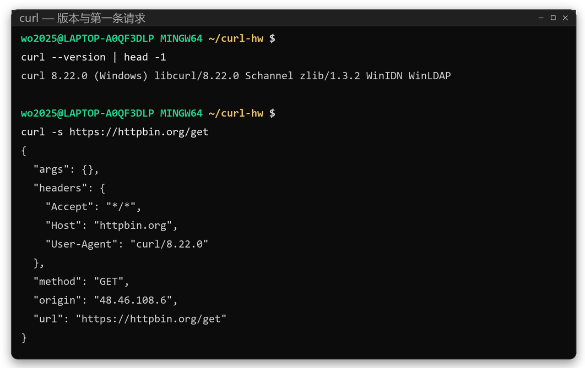
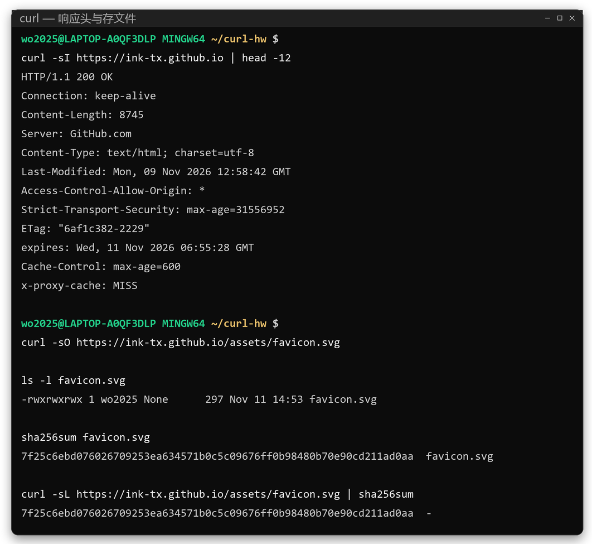
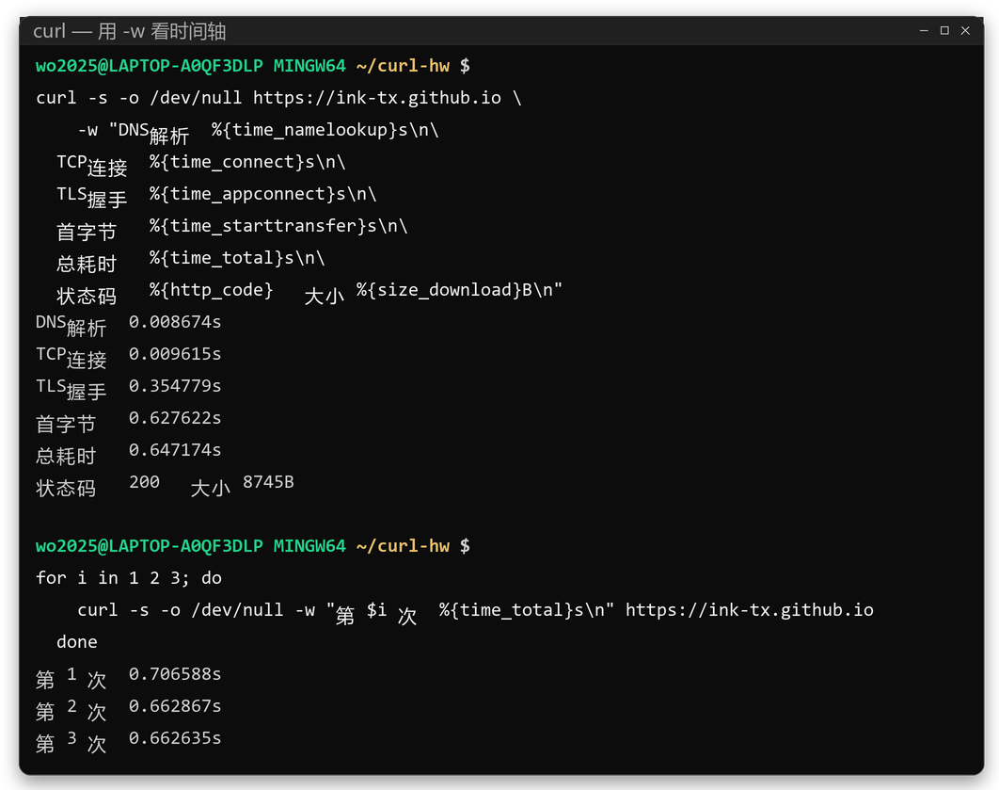
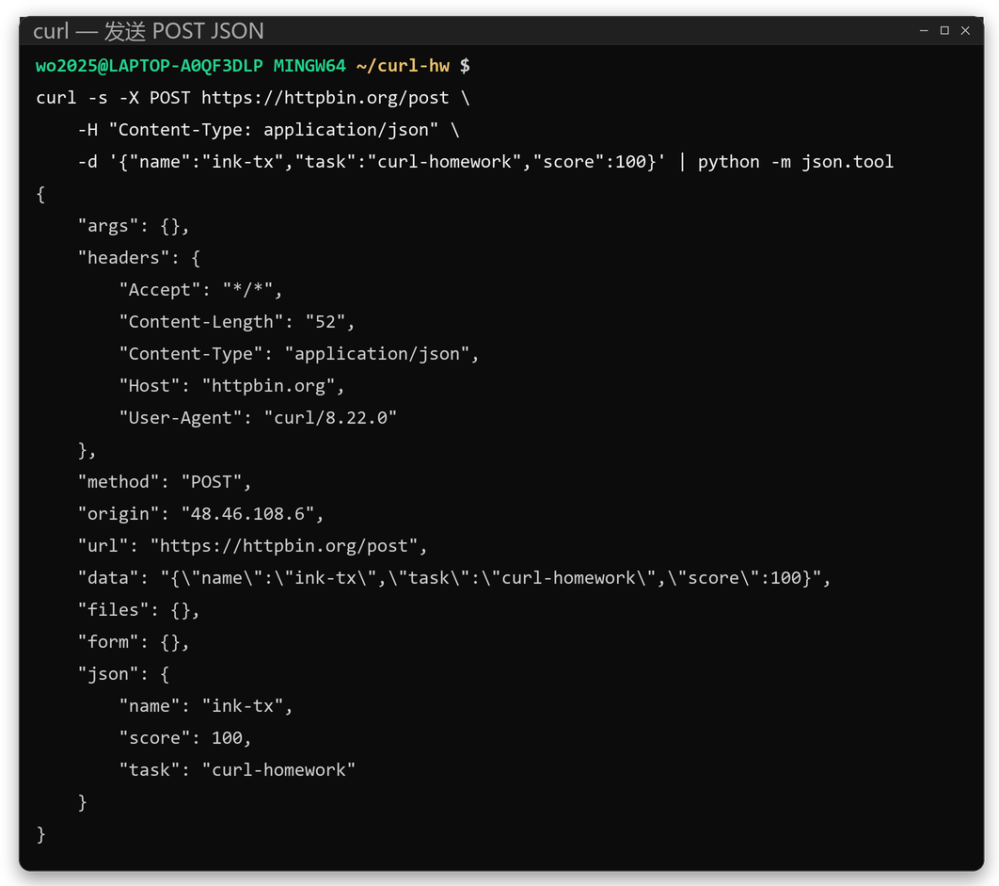
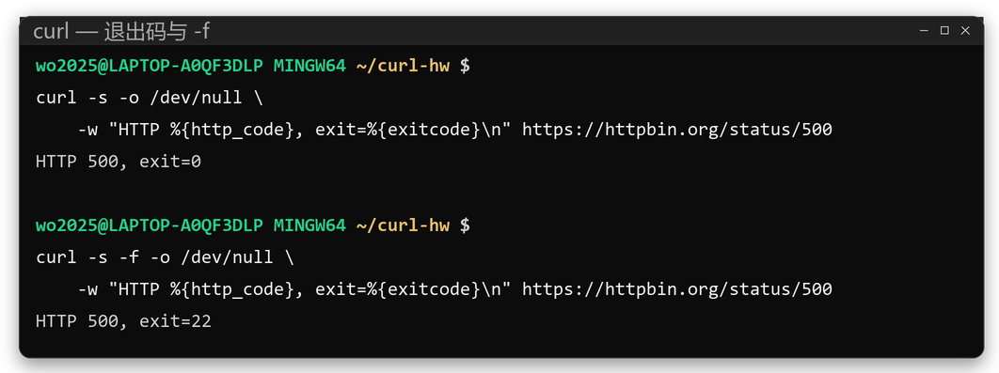
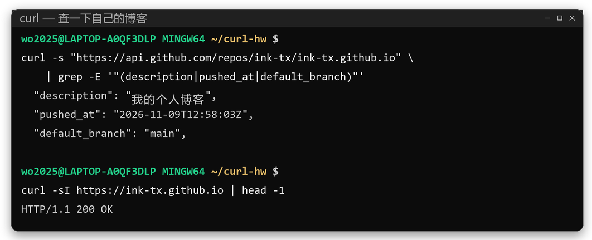

## 摘要

curl 是命令行环境下最常被调用的 HTTP 客户端，但它的输出通常只被当作结果消费，很少被当作证据阅读。本文以 curl 8.22.0 为观测工具，对一个部署于 GitHub Pages 的静态站点与两个回显服务发起六组请求，分别考察请求头的默认构成、响应字段的语义、一次完整交互的时间分布，以及 HTTP 状态码与进程退出码之间的关系。观测得到三点结论：其一，curl 默认只发送三个请求头，与浏览器的默认行为存在显著差异，这一差异源于"最小假设"与"最大协商"两种不同的设计取向；其二，在本次冷连接测量中，TLS 握手占单次请求总耗时的 53.33%，是主要成本，而 TCP 连接仅占 0.15%；其三，HTTP 5xx 响应不改变 curl 的退出码，只有启用 `-f` 时才映射为退出码 22。据此，本文给出一组适用于自动化探活的参数组合，并说明其阈值的来由与局限。

## 一、问题的提出

在接口调试与脚本编写中，curl 的使用往往止于"命令能跑通"。至于请求里究竟带了哪些头、一次交互的时间花在哪里、命令的成败由什么判定，多数时候并不深究。这种使用方式在顺利时无碍，一旦出现问题便难以定位：服务端按表单解析了 JSON、超时阈值设得过紧、把 502 页面当成成功响应下载下来，都是常见的后果。

本文因此把问题拆成三个可以观测的层面：

1. 请求由什么构成——在不加任何参数时，curl 究竟发送了什么；
2. 时间由什么构成——一次 HTTPS 交互的各阶段各占多少；
3. 成败由什么判定——当服务器返回错误状态码时，命令的成败如何被表达。

观测对象为三个：本站 `ink-tx.github.io`（托管于 GitHub Pages，用于 HTTPS 与时序观测）、`httpbin.org`（回显服务，用于请求构成与请求体观测）、`api.github.com`（以 JSON 形式提供仓库元数据，用于第九节的自指观测）。

## 二、观测环境与方法

<p class="tbl-cap">表 1　观测环境</p>

| 项目 | 取值 |
| --- | --- |
| 客户端 | curl 8.22.0 (Windows) libcurl/8.22.0 |
| 构建特性 | Schannel、zlib/1.3.2、WinIDN、WinLDAP |
| 终端 | Git Bash（MINGW64），Windows 11 |
| 观测时间 | 2026-11-11 14:48–14:51（UTC+8） |
| 站点 | https://ink-tx.github.io |

方法上有一点需要说明：六个观测片段中的命令并非事后整理，而是由脚本逐条执行，命令文本与被执行的内容同源，输出原样记录，未作删改。这样处理的目的很实际——读者按文中的命令重跑，应当得到结构相同的结果；若某处输出无法复现，该处结论也就不值得采信。

## 三、请求的构成：默认头的取舍

<figure>
  
  <figcaption>图 1　版本信息与首个 GET 请求：回显中 headers 只有三项</figcaption>
</figure>

`curl --version | head -1` 给出构建信息：`curl 8.22.0 (Windows) libcurl/8.22.0 Schannel zlib/1.3.2 WinIDN WinLDAP`。后四项是构建特性，其中没有 HTTP2 与 HTTP3 —— 这意味着本文后续观测到的全部是 HTTP/1.1 上的行为；若需 HTTP/2 观测，须换用包含该特性的构建，相关结论也需要重新测量（见第十二节）。

接着 `curl -s https://httpbin.org/get` 把请求原样回显。值得注意的是 `headers` 字段只有三项：

```json
"Accept": "*/*",
"Host": "httpbin.org",
"User-Agent": "curl/8.22.0"
```

也就是说，在没有任何配置的情况下，curl 不发送 `Accept-Encoding`、`Accept-Language`、`Connection`、`Cookie`、`Referer`，也不做内容协商。

这与浏览器的行为形成对照。浏览器必须假定服务器会按内容协商返回不同表示，需要缓存验证与 Cookie 会话，还需要维持一套可被识别的指纹，因此默认头多；curl 则假定调用者清楚自己要什么，多余的头只会引入不可控的变量。两种取向并无优劣，但取舍的后果需要被意识到：用 curl 复现浏览器侧的问题时，必须显式补齐头，`-H` 正是为此存在；反过来，用浏览器复现 curl 侧的表现时，那些头恰恰是要排除的噪声。

## 四、响应的语义：从字段读出服务器的意图

<figure>
  
  <figcaption>图 2　HEAD 请求的响应头，以及落盘文件的 sha256 校验（两段哈希一致）</figcaption>
</figure>

`curl -sI` 发送 HEAD 请求，只取响应头而不要正文。表 2 从十二个字段中摘出六个。

<p class="tbl-cap">表 2　响应头摘录与语义</p>

| 字段 | 观测值 | 含义 |
| --- | --- | --- |
| 状态行 | `HTTP/1.1 200 OK` | 协议版本、状态码与原因短语 |
| Content-Length | `8745` | 响应体字节数 |
| Content-Type | `text/html; charset=utf-8` | 媒体类型与字符集 |
| ETag | `"6af1c382-2229"` | 内容指纹，用于条件请求 |
| Cache-Control | `max-age=600` | 响应可缓存 600 秒 |
| Strict-Transport-Security | `max-age=31556952` | 一年内强制 HTTPS 访问 |

其中 ETag 一项值得单独说明。它的形式为 `"6af1c382-2229"`，两段都是十六进制：第一段 0x6af1c382 = 1794229122，换算后正是 `Last-Modified` 所指的 2026-11-09 12:58:42 UTC；第二段 0x2229 = 8745，正是 `Content-Length`。这是 nginx 系静态服务的惯例——把内容指纹退化为"修改时间 + 长度"。它的实际含义是：只要文件未被替换，ETag 就不变，客户端可用 `If-None-Match` 换取 304，省掉一次正文传输。同理，`Cache-Control: max-age=600` 与 `x-proxy-cache: MISS` 一起说明响应经过了 CDN 缓存层，且本次未命中。

随后 `curl -sO` 把响应体按原名落盘，得到 297 字节的 `favicon.svg`。但"下载成功"与"下载正确"是两件事，因此又用 `sha256sum` 对本地文件与服务器字节各算一次哈希：两者均为 `7f25c6eb…d0aa`（图 2 下半部分）。这一步在形式上只是多敲一条命令，在工程上却是把"请求是否成功"与"内容是否完整"分开检验的起点——传输被中间设备截断、或响应被错误页面替换时，返回码可能依然正常。

## 五、时间的去向：累计计时与分段还原

<figure>
  
  <figcaption>图 3　<code>-w</code> 打印的五段累计时间，以及同一命令连续三次的总耗时</figcaption>
</figure>

`-w` 允许在请求结束后打印一组统计变量。这里有一个容易踩的坑：`time_namelookup`、`time_connect`、`time_appconnect`、`time_starttransfer`、`time_total` 全部是自请求开始起的累计值，而非各阶段耗时。把它们直接当作阶段时间相加，会得到明显偏大的总数；正确做法是相邻相减。

<p class="tbl-cap">表 3　累计读数与分段还原（单位：秒）</p>

| 阶段 | 累计变量 | 读数 | 分段 | 占比 |
| --- | --- | --- | --- | --- |
| DNS 解析 | time_namelookup | 0.008674 | 0.008674 | 1.34% |
| TCP 连接 | time_connect | 0.009615 | 0.000941 | 0.15% |
| TLS 握手 | time_appconnect | 0.354779 | 0.345164 | 53.33% |
| 首字节等待 | time_starttransfer | 0.627622 | 0.272843 | 42.16% |
| 内容传输 | time_total | 0.647174 | 0.019552 | 3.02% |

按此还原后，有两个观察值得记录。

第一，TLS 握手是单次冷连接的主要成本。本例中它耗时 0.3452 秒，占总时间的 53.33%，而建立 TCP 连接只用了 0.94 毫秒。二者的量级差异说明：在公网环境下，连接的"安全开销"远大于"建连开销"。这也解释了连接复用为何在客户端优化中占据核心地位——第二次请求若命中同一连接，这 0.3452 秒完全消失。诊断"网站慢"时，先分清是首次访问慢还是持续慢，依据就在这里。

第二，首字节等待（0.2728 秒）包含服务端处理与首包回传两部分，其中含 CDN 回源的代价，不能等同于源站的计算时间。把该值直接读作"后端响应慢"，是常见的误判。

需要指出的是，单次测量的代表性有限。同一命令连续执行三次，总耗时分别为 0.706588、0.662867、0.662635 秒，均值 0.677363 秒，极差 0.043953 秒，约为均值的 6.5%。这三次的离散并不算大，但它们只覆盖了半分钟内的连续调用；第八节的探活脚本在不同时段独立运行，对同一目标测得 0.940644 秒，比这三次的均值高出约 39%。也就是说，同一目标处在"正常"状态时，耗时可以从 0.66 秒一直摆到 0.94 秒。这一离散度直接决定了下一节探活阈值的取法：阈值若卡在 1 秒左右，距最慢的一次观测只剩 6% 的余量，误报几乎必然。

## 六、请求体：`-d` 的默认行为与覆盖

<figure>
  
  <figcaption>图 4　POST JSON：Content-Length、data 与 json 三个字段互相印证</figcaption>
</figure>

`-d` 有两个容易被忽略的默认行为：一是隐含 `-X POST`，二是在未指定时把 `Content-Type` 设为 `application/x-www-form-urlencoded`。发送 JSON 时若只写 `-d '{...}'` 而不加 `-H`，服务端多半按表单解析，拿到的是一串字面量而不是结构化字段。

本例显式指定 `Content-Type: application/json`，回显中三个字段可以互相印证：`Content-Length: 52` 与请求体字节数一致；`data` 保留了原始 JSON 文本；`json` 字段是服务端解析后的对象，`name`、`task`、`score` 分别为 `ink-tx`、`curl-homework`、`100`。三个字段同时正确，才能说明"发出去的是 JSON，收到的也是 JSON"。

还有两点实践提醒：`-d @file` 从文件读取请求体，但会去掉其中的换行，需要保真字节时应改用 `--data-binary`；`-d` 与 `-F`（multipart 表单）互斥，混用会让请求体被拼成非预期形式。

## 七、成败的判定：状态码与退出码的分离

<figure>
  
  <figcaption>图 5　同一 500 端点：不加 <code>-f</code> 时退出码 0，加 <code>-f</code> 时退出码 22</figcaption>
</figure>

对同一个返回 500 的端点执行两次，差别只在于是否加 `-f`：不加时输出 `HTTP 500, exit=0`，加了输出 `HTTP 500, exit=22`。

这一结果初看反直觉，实则是职责划分的结果。curl 负责传输，不负责解释。服务器返回 500 时，curl 已经把对方的回答完整地带了回来，传输本身是成功的，退出码 0 表达的正是这个事实。把状态码判断留给调用方，换来两件事：脚本可以取回任意响应（包括错误页正文）而不被判为失败；"什么算失败"由业务决定，而不由工具预设。

`-f` 改变的就是这一默认：当响应状态码大于等于 400 时，curl 停止输出正文并以 22 退出。常用退出码见表 4。

<p class="tbl-cap">表 4　常见退出码（据 curl 手册）</p>

| 退出码 | 含义 | 触发场景 |
| --- | --- | --- |
| 0 | 传输完成 | 无论状态码是 200 还是 500 |
| 6 | 无法解析主机 | DNS 失败 |
| 7 | 无法建立连接 | 端口不通、被防火墙丢弃 |
| 22 | HTTP 错误 | 配合 `-f`，状态码 ≥ 400 |
| 28 | 操作超时 | 触发 `--max-time` 或 `--connect-timeout` |

需要注意 `-f` 的两个副作用：其一，正文不再输出，若仍需错误页内容，应放弃 `-f` 而自行判断状态码；其二，与 `--retry` 同用时 5xx 也会进入重试，本例在 `--retry 2` 下共发出三次请求才最终放弃（见第八节实测）。

## 八、工程化封装：探活脚本的参数选择

一个可用的探活脚本，价值不在于命令多，而在于每个参数都能说出理由。

```bash
#!/usr/bin/env bash
set -uo pipefail

url="https://ink-tx.github.io"

out=$(curl -sS -o /dev/null -f \
           --connect-timeout 3 --max-time 5 \
           --retry 2 --retry-all-errors --retry-delay 1 \
           -w '%{http_code} %{time_total}' "$url")
rc=$?

if [ "$rc" -ne 0 ]; then
  printf '探活失败：curl 退出码 %s\n' "$rc" >&2
  exit 1
fi

read -r code total <<< "$out"
printf '状态 %s，耗时 %s 秒\n' "$code" "$total"
```

<p class="tbl-cap">表 5　探活脚本的参数取舍</p>

| 参数 | 作用 | 取舍 |
| --- | --- | --- |
| `-sS` | 静默进度，但保留错误信息 | 只用 `-s` 会把错误一并吞掉，`-S` 把它补回 |
| `-f` | 状态码 ≥ 400 时以 22 退出 | 代价是不再输出错误页正文 |
| `--connect-timeout 3` | 连接阶段上限 | 与 `--max-time` 分工：前者防连不上，后者防整体挂起 |
| `--max-time 5` | 单次请求总上限 | 约为实测上限的 6 倍，理由见下 |
| `--retry 2 --retry-all-errors` | 瞬时故障重试 | 默认只重试传输类错误，加后才覆盖 5xx |
| `-o /dev/null` | 丢弃正文 | 只关心状态与时序时的标准做法 |
| `-w '%{http_code} %{time_total}'` | 结构化输出 | 便于用 `read` 拆分，不必解析人类可读文本 |

阈值的取法直接来自第五节的测量：冷连接总耗时落在 0.66–0.94 秒之间（三次连续采样为 0.663–0.707 秒，另一次跨时段独立运行为 0.940644 秒），其中 TLS 一项约占一半。因此 `--max-time` 取 5 秒，约为最慢一次观测的 5.3 倍，既能覆盖 CDN 回源与移动网络的抖动，又不至于在真正故障时长时间挂起。若把该值设为 1 秒，则上述正常波动中最慢的 0.940644 秒距阈值仅剩 6%，误报几乎必然发生。

该脚本在本站与 500 端点上的实测结果分别为 `状态 200，耗时 0.940644 秒`（退出码 0）与 `探活失败：curl 退出码 22`（退出码 1），与设计意图一致。

## 九、案例：对自身站点的观测

<figure>
  
  <figcaption>图 6　以 curl 读取本站仓库元数据，并对站点发起 HEAD 请求</figcaption>
</figure>

最后把 curl 指向本文所在的仓库与站点，作为一次自指观测。仓库元数据给出三个字段：`description` 为"我的个人博客"，`default_branch` 为 `main`，`pushed_at` 为 `2026-11-09T12:58:03Z`；而站点对 HEAD 请求返回 `HTTP/1.1 200 OK`。

两组时间信息放在一起才显出意义：`pushed_at` 是最后一次推送的时刻，页面的 `Last-Modified`（第四节）是 Pages 构建产物的时刻，二者并不相等。这个差值就是构建延迟的度量——本站的观测值在 30 至 45 秒之间。它提醒我们：在 CI/CD 链路中，"推送成功"与"站点生效"是两个事件；用 curl 做上线校验时，必须为二者之间的间隔留出重试窗口，否则会把正常的构建延迟误判为发布失败。

## 十、参数速查

<p class="tbl-cap">表 6　常用参数速查</p>

| 需求 | 参数 |
| --- | --- |
| 只取响应头 | `-I` |
| 跟随重定向 | `-L` |
| 静默 / 显示错误 | `-s` / `-S` |
| 按原名保存 | `-O` |
| 保存到指定文件 | `-o file` |
| 断点续传 | `-C -` |
| 限制速率 | `--limit-rate 200k` |
| 超时控制 | `--connect-timeout` / `--max-time` |
| 失败重试 | `--retry N --retry-delay S` |
| 自定义头 | `-H "Key: Value"` |
| 发送 JSON | `-H "Content-Type: application/json" -d @body.json` |
| 发送表单 | `-F "key=value"` |
| 只看状态码 | `-o /dev/null -s -w '%{http_code}'` |
| 查看时序 | `-w '%{time_total}'` |
| 指定代理 | `-x http://host:port` |
| 忽略证书（仅调试） | `-k` |

## 十一、实施中的问题

以下三项，一项来自测量限制，两项来自 Windows 环境的实际约束。

**其一，Windows 下的引号要过两层解析。** 在 Git Bash 中单引号可用，但当命令经 cmd 转交原生 `curl.exe` 时，cmd 会先做一次引号解析，再由程序接收参数。因此 `.bat` 中应统一使用双引号，且百分号需写成 `%%`，否则会被当作环境变量展开。

**其二，`/dev/null` 依赖 MSYS 的路径转换。** 本文的 `-o /dev/null` 在 Git Bash 下工作正常，是因为 MSYS 会把该路径映射到 Windows 的空设备；若在 cmd 或 PowerShell 中直接调用 `curl.exe`，应写作 `NUL`。

**其三，`-I` 默认不跟随重定向。** 对 301/302 的端点，`-I` 只显示第一跳的响应头；若需看到最终资源，应加 `-L`。但要注意 `-L` 会让 `time_total` 包含多次请求，第五节的时序解读方法在此不再适用，需结合 `num_redirects` 与 `time_redirect` 重新拆分。

## 十二、局限

本文的结论受限于以下条件，引用时需一并考虑：

1. 样本为单机、单运营商、单时段的三次重复，仅足以说明数量级与波动范围，不足以支撑统计推断。
2. 观测所用构建不含 HTTP/2 特性，全部测量发生在 HTTP/1.1 上。HTTP/2 的多路复用会改变连接与首字节的耗时结构，本文的占比结论不直接适用。
3. 未测量连接复用。若在同一连接上发起第二次请求，TCP 与 TLS 阶段的成本将消失，第五节的占比结构随之改变。
4. 时序包含 CDN 边缘节点的影响，反映的是"从本机到边缘"的路径，不代表源站性能。
5. 第六节的请求体观测仅覆盖 JSON，未涉及 multipart 与流式上传。

## 十三、结论

1. curl 的默认请求是"最小假设"的产物：三个头，无内容协商。它以牺牲通用性换取可预测性，复现浏览器场景时必须显式补齐请求头。
2. 单次 HTTPS 冷连接的成本主要落在 TLS 握手（本例 53.33%），而非 DNS 或 TCP。这一结构决定了连接复用与长连接优化的收益上限。
3. `-w` 提供的时间变量是累计值，分段需相邻相减；单次测量不足以支撑性能结论，本例三次重复的极差为均值的 6.5%，而跨时段的一次独立运行较均值高出约 39%。
4. 状态码与退出码的分离是 curl 的设计选择：默认只在传输失败时返回非零，`-f` 把 HTTP 错误纳入失败判定。脚本中的成败标准应由调用方明确设定，而非默认继承。

## 参考资料

1. R. Fielding, M. Nottingham, J. Reschke. *HTTP Semantics*. RFC 9110, IETF, 2022. <https://www.rfc-editor.org/rfc/rfc9110>
2. R. Fielding, M. Nottingham, J. Reschke. *HTTP/1.1*. RFC 9112, IETF, 2022. <https://www.rfc-editor.org/rfc/rfc9112>
3. E. Rescorla. *The Transport Layer Security (TLS) Protocol Version 1.3*. RFC 8446, IETF, 2018. <https://www.rfc-editor.org/rfc/rfc8446>
4. D. Stenberg. *curl — transfer a URL*. curl 8.22.0 manual. <https://curl.se/docs/manpage.html>
5. GitHub. *GitHub Pages documentation*. <https://docs.github.com/pages>
